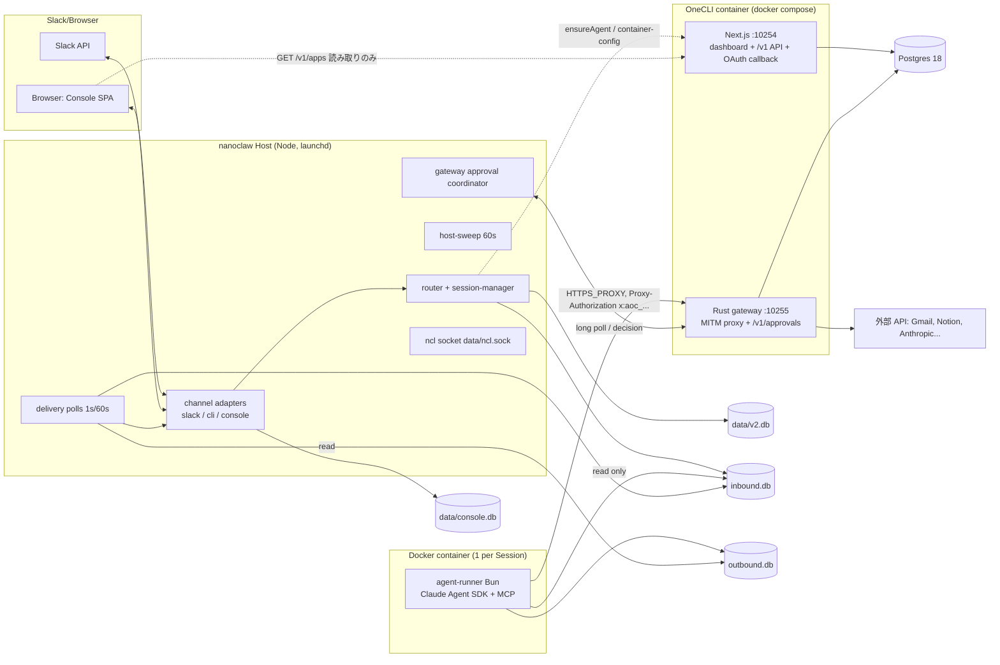
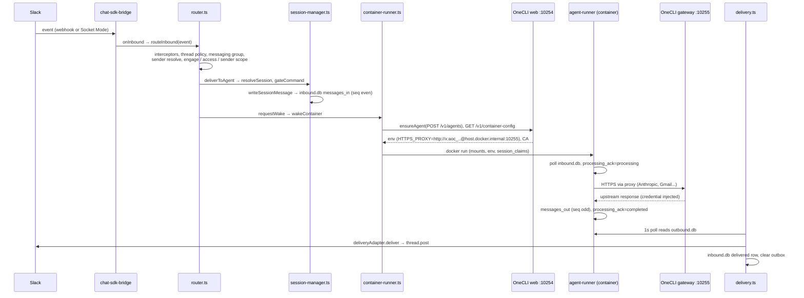
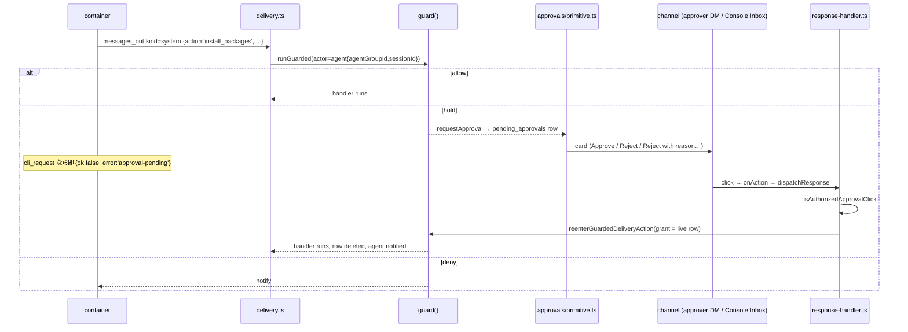
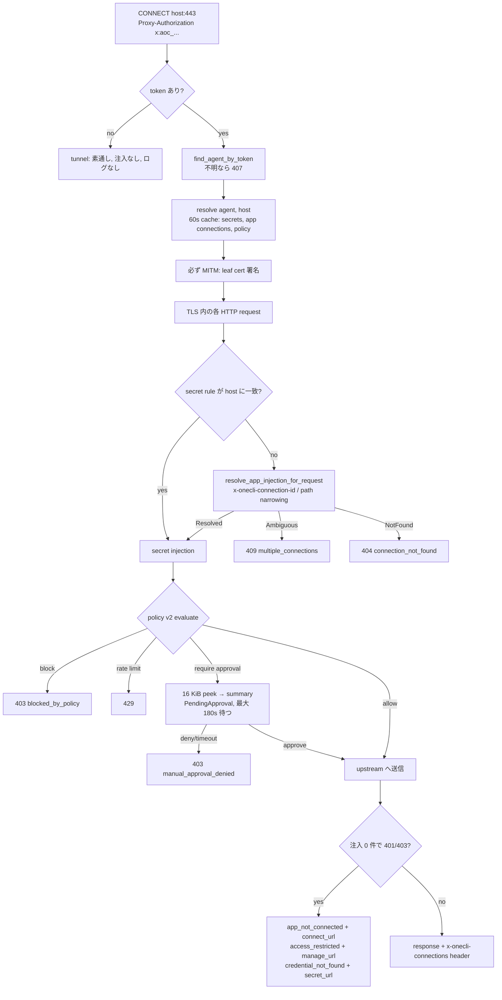
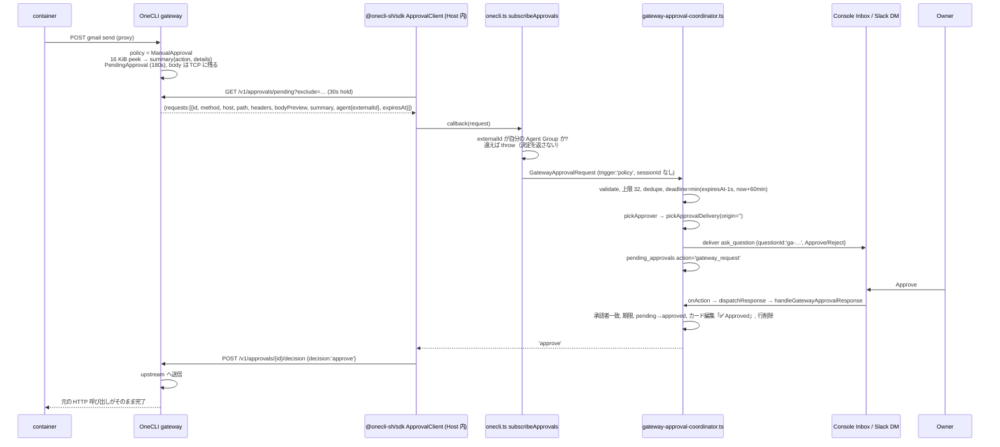
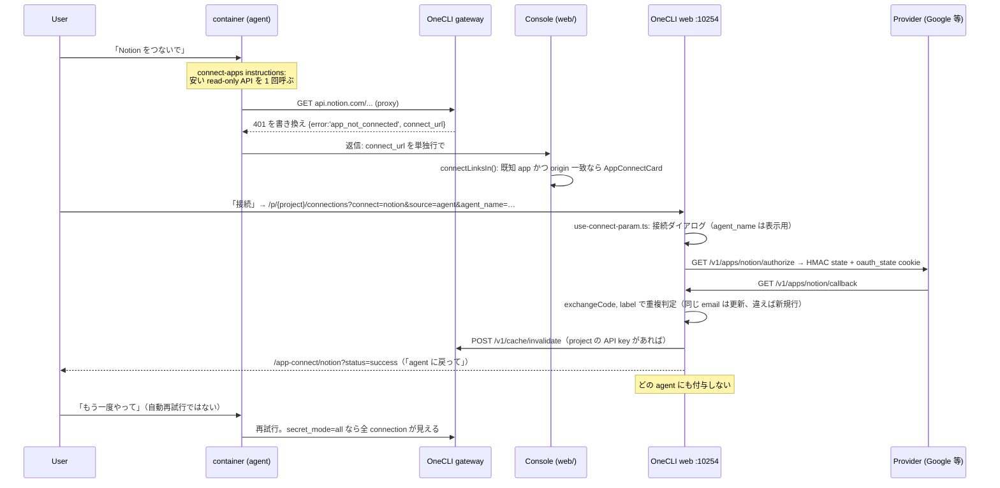

# kurumi が置き換える 2 つのシステムと、kurumi が従う monica の作り

対象:

- nanoclaw: `~/.ghq/src/github.com/ashigirl96/nanoclaw`（HEAD `966dad1c`）
- OneCLI v1.42.0: `git -C ~/.ghq/src/github.com/onecli/onecli archive v1.42.0` で取り出した source（commit 3912c74、OSS edition）。以下 OneCLI の path はその root からの相対 path。
- monica: `~/.ghq/src/github.com/ashigirl96/monica`

元の調査は explorer 1〜4 の 4 ファイル（設計の session の作業ファイルで、repo には置いていない）。食い違いと未解決の問いのうち、コードで閉じられたものはこの文書で閉じた（「Gotchas」の末尾に一覧）。

---

## Overview

nanoclaw は 1 つの Node process（Host）と、Session ごとに 1 つずつ立つ Docker container（agent-runner）でできている。Host は中央の SQLite `data/v2.db` を 1 人で書き、Slack・CLI socket・Console（fork 独自の web UI）の channel adapter を持ち、poll loop で container の出力を platform に配達する。Host と container の間の通信路は、Session ごとの 2 つの SQLite ファイルだけである。`inbound.db` は Host が書いて container が読み、`outbound.db` は container が書いて Host が読む。agent が Host に何かを頼むとき（`ncl` の実行、agent の作成、package の追加）も、`outbound.db` に `kind:'system'` の行を書く。container の外向き HTTP(S) は環境変数 `HTTPS_PROXY` で OneCLI gateway を通り、gateway が TLS を MITM して credential を差し込む。

OneCLI v1.42.0 は 1 つの docker container の中で 2 つの process を動かす。10254 番の Next.js（dashboard と `/v1` 管理 API、OAuth callback）と、10255 番の Rust gateway（MITM proxy と、approval 用の小さな REST API）で、両者は Postgres だけを共有する。agent の身元は proxy URL の basic-auth password に入った agent token（`aoc_…`）で gateway に届く。nanoclaw は Agent Group 1 つにつき OneCLI Agent を 1 つ作る。monica は Bun monorepo で、1 つの Backend process が 1 つの SQLite を排他で開き、domain ごとの package（schema / contract / server / cli / ui の entry）を composition root が組み立てる。monica はデスクトップアプリの寿命（親が死んだら死ぬ、不在時の Job は捨てる）を前提にしており、常駐する kurumi にはそのまま当てはまらない規約がいくつかある。

---

## Key Concepts

| 用語 | 定義 |
|---|---|
| Host | nanoclaw の常駐 Node process（`src/index.ts`、launchd が `node dist/index.js` で起動）。`data/v2.db` の唯一の writer。 |
| Agent Group | agent 1 体分の設定と workspace。`agent_groups` + `container_configs`（1:1）、filesystem は `groups/<folder>/`。OneCLI 側では 1 Agent Group = 1 OneCLI Agent（`identifier = agent_groups.id`）。 |
| Messaging Group | 1 つのチャット（Slack channel / DM / Console chat）。`messaging_groups(channel_type, platform_id, instance)`。 |
| Wiring | Messaging Group と Agent Group の結線（`messaging_group_agents`）。engage mode、session mode、sender scope、accumulate などを持つ。 |
| Session | 1 つの会話文脈。`sessions` 行 + `data/v2-sessions/<agent_group_id>/<session_id>/` フォルダ。mode は `shared`（chat ごと）/ `per-thread` / `agent-shared`。Task は series ごとに専用 Session。 |
| Mailbox | Session フォルダの `inbound.db`（Host → container）と `outbound.db`（container → Host）。 |
| agent-runner | container 内の Bun process（`container/agent-runner/src/index.ts`）。`inbound.db` を 1 秒ごとに poll し、Claude Agent SDK を回し、結果を `outbound.db` に書く。 |
| Destination | agent が宛先を名前で指す仕組み。`agent_destinations`（中央）を `inbound.db` の `destinations` に射影。agent は platform id を見ない。 |
| System Action | `outbound.db` の `kind:'system'` 行。Host の `registerDeliveryAction` で登録された handler が実行する。 |
| Guard | `guard(action, input)` → `allow` / `hold` / `deny`（`src/guard/guard.ts`）。hold は Approval を経て grant 付きで再入する。 |
| Approval | 承認カード（Approve / Reject / Reject with reason…）。`pending_approvals` 行。承認者は scoped admin → global admin → owner の順に、届く DM を持つ最初の人。 |
| Credential Approval | gateway が保留した HTTP request の承認。nanoclaw では `src/gateway-approval-coordinator.ts` が扱い、`pending_approvals.action='gateway_request'`。 |
| Gateway seam | `GatewayProviderDefinition`（`src/gateway-providers/gateway-provider-registry.ts`）。gateway ごとの adapter が `sessions.ensure`、`approvals.subscribe`、`connections.connect` などを実装する。 |
| OneCLI Agent | OneCLI の principal。`agents.access_token`（`aoc_…`）、`secret_mode`（既定 `all`、または `selective`）。 |
| Secret | 手入力の credential（Anthropic、OpenAI、generic）。host/path pattern で差し込み先を決める。 |
| AppConnection（Connected Account） | OAuth などで接続した 1 アカウント。`provider` + `label`（email など）。同じ provider の行を複数持てる。 |
| AgentAppConnection | Agent と AppConnection の多対多の付与（selective mode 用）。 |
| Console | nanoclaw fork 独自の web UI。Host process 内の `http.Server`（`127.0.0.1:$CONSOLE_PORT`）で、channel adapter の 1 つ。自前の `data/console.db` を持つ。 |
| Backend（monica） | monica の composition root（`apps/backend/src/main.ts`）。`monica.db` を `locking_mode=EXCLUSIVE` で開く唯一の process。 |
| `<D>Ledger`（monica） | domain ごとに 1 つの instance。`start()` / `stop()` / `events` と、他 domain が呼ぶ同期の書き込みメソッド（`tx` が第 1 引数）だけを公開する。 |
| systemJobs（monica） | domain が timer を持たず、`{ name, every, run }` の配列を Job Ledger に渡す仕組み。 |

---

## How It Works

### 1. プロセス境界と、どの DB を誰が書くか

| 保存先 | writer | reader | 備考 |
|---|---|---|---|
| `data/v2.db`（中央） | Host のみ | Host、`scripts/q.ts` | migrations は `src/db/migrations/` の番号付きファイル、ledger は `schema_version`。async の `DbDriver` seam（`src/db/driver.ts`）。 |
| `data/v2-sessions/<ag>/<sid>/inbound.db` | Host のみ | container（read-only、`mmap_size=0`） | `messages_in`（seq 偶数）、`delivered`、`destinations`、`session_routing` |
| `data/v2-sessions/<ag>/<sid>/outbound.db` | container のみ | Host | `messages_out`（seq 奇数）、`processing_ack`、`session_state`、`container_state` |
| `data/console.db` | Host（Console adapter） | Host | `messages`、`files`、`read_positions`、`chat_read_positions`、`group_chats`、`group_chat_members`、`agent_group_appearance` |
| `groups/<folder>/` | Host（CLAUDE.md、container.json を毎 spawn 生成）と container（memory、作業ファイル） | 両方 | `CLAUDE.md` は read-only で上から mount される |
| `data/v2-sessions/<ag>/.claude-shared/` | container（SDK 状態）と Host（skill symlink） | 両方 | `/home/node/.claude` に mount |
| `data/onecli/` | Host | container（read-only mount） | CA と stub を content-addressed で配置、古い版は消さない |
| OneCLI Postgres | web（Prisma）と gateway（SQLx）の両方 | 両方 | gateway は token refresh 結果と `request_logs` を書く |
| OneCLI `/app/data` volume | entrypoint、gateway | gateway | CA key/cert、`SECRET_ENCRYPTION_KEY` |

mailbox を 2 ファイルに分けた理由は Docker Desktop の VirtioFS にある。WAL の `-shm` mmap は VirtioFS をまたいで一貫しないので、guest 側の WAL reader が古い snapshot のまま止まる。そこで両ファイルとも `journal_mode=DELETE` にし、1 ファイル 1 writer にした。container は自分の入力を「処理済み」にすることさえできず、`outbound.db` の `processing_ack` に書き、Host の sweep がそれを `messages_in.status` に写す。kurumi の決定 3（「host の 1 つの SQLite ファイルがすべてを持つ」）は、この制約とぶつかる（Gotchas 参照）。

### 2. Host の起動順（`src/index.ts`）

1. `enforceStartupBackoff()`（`src/circuit-breaker.ts`、短時間の再起動に指数 backoff）→ `enforceUpgradeTripwire()` → `getGatewayProvider()`。gateway provider が登録されていなければここで throw する。gateway なしで動く mode はない。
2. `initDb('data/v2.db')` → `runMigrations` → `backfillContainerConfigs`。
3. side-effect import で channels（cli, slack, slack-a2a-guard, slack-a2a, console）、modules（mailbox compose, approvals, interactive, permissions, agent-to-agent, self-mod, community-portal, slack-room-membership, canvas-actions, slack-onboarding, slack-agent-flow）、`cli/commands`、`cli/delivery-action.ts` が登録済み。barrel の import 順に意味がある（slack-agent-flow は agent-to-agent の後に `create_agent` を上書き登録する）。
4. `getSessionDriver().ensureReady()` → `startHostInstanceLease()`（`host_instances`）→ `createInboundGate()`。
5. `initChannelAdapters(...)`。`onInbound` は `instance` を付けて `routeInbound` を呼ぶが、gate が開くまで待たせる。
6. `setDeliveryAdapter(createChannelDeliveryAdapter())` → `startGatewayApprovalCoordinator(...)` → `startGatewayAvailabilityMonitor`（OneCLI は `availability` を実装しないので no-op）。
7. `adoptRunningSessions()`（Host 再起動を生き延びた container を claim で fence して再接続し、gateway lease も `disposition:'adopt'` で取り直す）→ `inbound.release()` → `startHostModules` → delivery polls → `startHostSweep` → `startCliServer`（`data/ncl.sock`、0600）。

### 3. Slack の 1 メッセージが返信になるまで

1. **Platform → adapter.** Slack event は `@chat-adapter/slack`（`WEBHOOK_PORT` の webhook か Socket Mode）に届く。`src/channels/chat-sdk-bridge.ts` が `setup.onInbound(platformId, threadId, {id, kind:'chat-sdk', content, isMention, isGroup})` を呼ぶ。bot が書いた message はここで捨てる（allowlist された A2A room だけ例外、hop limit あり）。添付は bridge が取得して base64 で inline にする（`docs/architecture.md` の「host は media を落とさない」は古い）。
2. **`routeInbound`（`src/router.ts`）.** message interceptor（reject 理由の取り込み、Chat Registration の名前返信）が消費しうる。`messaging_groups` を引き、無ければ bot が呼ばれたときだけ自動作成する。wiring が 0 本なら `unregistered_senders` に記録し、owner に Chat Registration カードを出して止まる。sender を `users` に upsert（`slack:U123`）。wiring ごとに thread policy → `evaluateEngage`（`pattern` / `mention` / `mention-sticky`）→ access gate（unknown sender policy + `canAccessAgentGroup`）→ sender scope gate。engage したら `deliverToAgent(..., wake=true)`、engage しないが `accumulate` なら `wake=false`、どれも当たらなければ `recordDroppedMessage`。
3. **`deliverToAgent`.** group chat で threads が有効なら `per-thread`。`resolveSession` が Session 行とフォルダを find-or-create する。`gateCommand`（`src/command-gate.ts`）が slash command を濾す（`/clear`、`/upload-trace`、`/compact` などは owner/admin のみ）。sibling Session から backfill。`writeSessionMessage` が `messages_in{id:'<platformMsgId>:<agentGroupId>', kind:'chat-sdk', seq 偶数, trigger, ...}` を書く（同じ platform message が複数 agent に配られるので id に Agent Group を付ける）。typing 開始、`requestWake(session,'inbound-message')`、sibling Session へ `session-echo` を配る。
4. **spawn（`spawnContainer`）.** `destinations` と `session_routing` を `inbound.db` に、runner context を `data/v2-sessions/<ag>/.context/<sid>.json`（0600）に書く。`materializeContainerJson`、`initGroupFilesystem`、`composeGroupProjectDoc`（CLAUDE.md 再生成）、skill symlink 同期、`buildMounts`、gateway lease（§6）、`composeSessionSpec`、`session_claims` の CAS claim、`docker run`、`sessions.container_status='running'`。失敗しても throw せず false を返し、sweep が再試行する。
5. **runner（`container/agent-runner/src/poll-loop.ts`）.** 1 秒 poll。`trigger=1` の行が無ければ待つ（accumulate gate）。`processing_ack(status='processing')` を upsert し、`formatMessages` が `<context timezone/>` + `<message id from sender time>` の XML を作る（platform id は落とす）。`ClaudeProvider.query(...)`。turn の途中に来た message は同じ query に流し込む。
6. **agent の出力.** MCP tool（`send_message` など）か、最終テキストの `<message to="name">…</message>` ブロック（`dispatchResultText` が 1 ブロック 1 行で `messages_out` に書く）。ブロック外や `<internal>` の中は配達しない。配達されずに turn が終わると 1 回だけ wrap の nudge を入れる。continuation は `session_state` に保存し、最後に必ず `processing_ack='completed'`（provider error でも completed にし、エラー文をユーザーに送る）。
7. **配達（`src/delivery.ts`）.** active poll（1 秒、container が動いている Session）と sweep poll（60 秒、全 active Session）、8 並列。`kind:'system'` → `handleSystemAction`、`task_log` → run log、`channel_type:'agent'` → agent 間 route、それ以外は ACL（origin chat は常に可、他は `agent_destinations` 行が必要）、`ask_question` なら `pending_questions` 行、outbox ファイル読み込み、`deliveryAdapter.deliver(...)`。3 回失敗（`delivery_attempts`）で `markDeliveryFailed`。配達後に typing 停止と sibling への echo。
8. **idle.** idle timer は無い。sweep の `reconcileSession`（`src/reconcile-session.ts`）が、heartbeat（`/workspace/.heartbeat` の mtime）が 30 分より古い container を kill する。claim 後 60 秒 heartbeat が無い container も kill して再試行する。次の message は新しい container を立て、`session_state` から SDK session を resume する。

### 4. Host↔container チャネルの細部

- **seq parity.** Host は偶数、container は奇数の `seq` を書く。2 テーブルをまたいで `seq` が 1 つの message id になり、`edit_message` / `add_reaction` がこれで対象を指す。
- **`on_wake` 行.** container の最初の poll でだけ返る。restart や self-mod が書く follow-up prompt を、SIGTERM の猶予中に死にかけの古い container が奪わないようにするため。`killContainer(sessionId, reason, onExit)` が「古い container の終了後に新しい container を spawn」を順序づける。
- **system 応答は trigger=0.** container 内の `ncl`（`container/agent-runner/src/cli/ncl.ts`）は `messages_out{kind:'system', content:{action:'cli_request', requestId, command, args}}` を書き、Host は結果を `messages_in{type:'cli_response'}`（`trigger=false`）として返す。poll loop は system 行を飛ばし、待っている tool だけがそれを読む。`ask_user_question` の回答（`question_response`）も同じ形。
- **container は敵対的とみなす.** MCP 側の検証は助言にすぎず、境界は Host の guard。
- **出力ファイル.** container が `outbox/<message_out_id>/` に置き、Host が読んで配達後に消す。入力添付は Host が `inbox/<msgId>/` に symlink 安全な `AnchoredDir` で書く。
- **mount（`buildMounts`）.** `/workspace` = Session フォルダ（RW）、`/workspace/agent` = `groups/<folder>`（RW）、その上に `container.json`、`CLAUDE.md`、`plugins/` を RO で重ねる。`/home/node/.claude` = `.claude-shared`（group ごと、RW）。`/app/src` = Host checkout の `container/agent-runner/src`（RO、build せず bun で実行するので、Host のコード更新が次の container 全部に効く）。`/app/skills` = `container/skills`（RO）。`/workspace/extra/*` = allowlist された追加 mount。gateway の CA と stub は `data/onecli/` から RO。
- **CLAUDE.md は毎 spawn 再生成.** persona（`instructions.prepend.md`）→ `container/CLAUDE.md` → native skills 節 → 各 `mcp-tools/*.instructions.md` → 選ばれた container skill の `instructions.md` → MCP server の instructions。サイズ上限を超えたら削れる節から落とす。`groups/<folder>/CLAUDE.md` を手で直しても消える。

### 5. System Action、Guard、Approval

- 定義済みの guarded action（`src/guard/guard-actions.ts`）: `self_mod.install_packages`、`self_mod.add_mcp_server`、`senders.admit`、`channels.register`、`agents.create`、`a2a.send`、`rooms.create`、`rooms.add_agent`、`console.agents.create`、`ncl` コマンドごとの `cli.<command>`（`src/cli/guard.ts`）。
- approve は「保存した action を実行する」のではない。guarded entry に `pending_approvals` の生きた行を grant として持たせて再入し、判定をもう一度 live で走らせる。grant は hold を満たすが deny は満たさない。行は解決後に消すので、grant は 1 回しか効かない。
- 承認者は `pickApprover`（`src/modules/approvals/primitive.ts:144`、group admin → global admin → owner）で並べ、`pickApprovalDelivery` が origin と同じ channel 種別の DM を優先して最初に届く人を選ぶ。DM は `ensureUserDm`（adapter の `openDM`、`user_dms` にキャッシュ）。カードは origin の chat には出ない。
- 「Reject with reason…」は、承認者の次の DM を理由として取り込む message interceptor（`reason-capture.ts`）。放置されたものは sweep の `approvals-scan` が片付ける。
- self-mod の apply は `container_configs` 更新 → package なら per-group image を rebuild（`buildAgentGroupImage`）→ kill → `on_wake` follow-up。

### 6. container spawn で agent の身元が gateway に届くまで

nanoclaw 側（`src/gateway-providers/onecli.ts` の `ensureSession`、L156〜）:

1. `onecli.ensureAgent({name: groupName, identifier: agentGroupId})` → `POST /v1/agents`（Bearer `oc_…` の project API key）。409 も成功扱い。毎 spawn 呼ぶが rename はしないので、Agent Group を改名しても OneCLI Agent の `name` は最初のまま残る（承認カードの「Agent:」と `connect_url` の `agent_name` に古い名前が出る）。
2. `onecli.getContainerConfig({agent: agentGroupId})` → `GET /v1/container-config?agent=…`。OneCLI（`packages/api/src/routes/container-config.ts`）は identifier で Agent を引き（無ければ 404 `AGENT_NOT_FOUND`）、次を返す:
   - `HTTPS_PROXY` / `HTTP_PROXY`（大小文字両方）= `http://x:<agent.accessToken>@<GATEWAY_BASE_URL>`。`GATEWAY_BASE_URL` の既定は `host.docker.internal:10255`（`packages/api/src/lib/env.ts:28`）。
   - `NODE_EXTRA_CA_CERTS=/tmp/onecli-gateway-ca.pem`、`NODE_USE_ENV_PROXY=1`、`GIT_TERMINAL_PROMPT=0`、`GIT_HTTP_PROXY_AUTHMETHOD=basic`。
   - Anthropic の OAuth token 用に `CLAUDE_CODE_OAUTH_TOKEN=placeholder`。kurumi は container に `CLAUDE_CODE_OAUTH_TOKEN=<group selector>` を渡し、gateway が `Authorization: Bearer <secret>` に差し替える。OpenAI は `OPENAI_API_KEY=placeholder` か `CODEX_HOME` + `~/.codex/auth.json` stub。
   - `caCertificate`、`caCertificateContainerPath`、`credentialStubs`、`warnings`。
3. `contributionFromConfig`: env をコピーし、CA を `data/onecli/ca-<sha>.pem` に、host の system CA と結合した bundle を `combined-<sha>.pem` に置いて `/tmp/onecli-combined-ca.pem` に mount し、`SSL_CERT_FILE` と `DENO_CERT` を設定する。stub も同様（ChatGPT の `account_id:"onecli-managed"` を `GET /v1/secrets` の metadata から実 ID に書き換える。Codex 用で、この fork は claude provider しか入れていない）。mount はすべて `{class:'allowlisted-extra', mode:'ro', groupScope}`。Host に `ANTHROPIC_BASE_URL` があれば `ANTHROPIC_AUTH_TOKEN=gateway-managed` と一緒に足す。
4. `networkAccess: {endpoint:'host.docker.internal', target:{kind:'runtime', identity:'onecli'}}`。docker driver の `dockerNetworkArgs` が、egress lockdown なら `--network nanoclaw-egress`、Linux なら `--add-host=host.docker.internal:host-gateway`、macOS なら何も付けない。
5. `monitorLease`: live lease を登録し、共有の 5 秒 `probeHealth`（`GET <ONECLI_URL>/v1/health`）を始める。
6. container 内では `HTTPS_PROXY` を尊重する HTTP client が `host.docker.internal:10255` に `CONNECT` し、`Proxy-Authorization: Basic base64("x:aoc_…")` を送る。

結果として、**OneCLI の身元は Session ではなく Agent Group 単位**である。同じ Agent Group の全 Session が 1 つの `aoc_` token を共有し、container 内の任意の process が env から読める。seam には `gatewayRuntimeIdentity` = `${installSlug}/${agentGroupId}/${sessionId}` があるが、OneCLI は使わない。そのため OneCLI の承認要求には `sessionId` が無い。

この install の OneCLI compose は 10254/10255 を `ONECLI_BIND_HOST=127.0.0.1` で publish しており、container はそれに `host.docker.internal:10255` で届いている。Docker Desktop for Mac では、host の loopback に publish した port に `host.docker.internal` から届くということである。Host process が自分で 127.0.0.1 に bind した listener にも同じように届くかは未検証（docker の port forwarder 経由ではないため）。

### 7. OneCLI gateway の 1 リクエスト

**CONNECT（`apps/gateway/src/gateway.rs` `handle_connect`）.** `inject::extract_agent_token`（`inject.rs:82`）が `Proxy-Authorization: Basic` の password を token として取る（password が空なら username）。token が無ければ plain tunnel。token があれば `connect::resolve` が `db::find_agent_by_token` で agent を引き（不明なら 407）、cache key `connect:{org}:{project}:{token}:{host}`、TTL 60 秒で解決結果を持つ。**認証済みの CONNECT は credential の有無に関係なく全部 MITM する**（`gateway.rs:665`）。401/403 を actionable な JSON に書き換えるため。CA は ECDSA P-256 の 10 年 CA（`{data_dir}/gateway/ca.key|ca.pem`）で、host ごとの leaf cert（24 時間）を `DashMap` にキャッシュする（`ca.rs`）。

**agent × host の解決（`connect.rs` `resolve_uncached`）.**

1. `load_connect_v2` が project の公開済み `policy_rules_v2` を読む。
2. `derive_inject_selection(&v2, agent_id)`（`policy_engine/inject_select.rs`）が、この agent を明示した `action="allow"` 規則（`source="equipment"`、`agent_secrets` / `agent_app_connections` を写したもの）から、選ばれた secret と connection を集める。
3. secret: selective かつ selection が空でなければ selection で絞る。selective で selection が空なら旧 join（`find_secrets_by_agent`）。`all` mode なら org + project の全 secret。host pattern で絞って復号し、OpenAI OAuth は期限切れなら refresh する。
4. app connection: `apps::providers_for_host(host)` が host に対応する provider を列挙する（`gmail.googleapis.com` → `gmail`、`www.googleapis.com` → gmail, google-calendar, google-drive… の path 付き）。候補行は secret と同じ 3 分岐（selective + selection / selective + 空 → `find_app_connections_by_agent` / all → `status='connected'` の全行）。復号はリクエスト時まで遅らせる。
5. `access_restricted` = secret rule 無し かつ agent が selective かつ project にこの host の credential がある。

explorer 2 は「selective なら `find_app_connections_by_agent` で付与分だけ」と書き、explorer 3 は「v2 の equipment rule が先、join は selection が空のときだけ」と書いた。コードは後者で、grant は join table と v2 equipment rule の 2 か所に同時に存在する。web 側の書き込みごとに `notifyPolicyCoherence` → `rematerializeOssScope` が equipment rule を作り直す。この bridge は best-effort でログを出すだけなので、失敗すると次の書き込みまで grant がずれる。

**リクエストごとの connection 選択（`connect.rs:555-721`、`mitm.rs` `resolve_rules`）.** secret が先に勝つ。host に一致する secret rule が 1 つでもあれば app connection は見ない（`mitm.rs:303`）。secret が無く connection がある場合:

- request header `x-onecli-connection-id` があればその connection を使う（候補に無ければ 404 `connection_not_found`、有効な一覧付き）。header は upstream に送る前に外す（`forward.rs:53`）。
- `narrow_connections_by_path` は `www.googleapis.com` のような path で provider が分かれる host でだけ効き、`/gmail/`、`/calendar/`、`/drive/` で絞る。
- 候補が 1 件ならそれ。provider ごとに 1 件ずつなら全部の rule を連結（path で振り分けられる）。provider 間で path が重なれば 409 `multiple_providers`。
- 同じ provider に 2 件以上残れば `Ambiguous` → **409 `multiple_connections`**（`response.rs:95`、`x-should-retry: false`、`connections:[{id,label,provider,display_name}]`、`header:"x-onecli-connection-id"`）。既定アカウントも、From アドレスによる選択も無い。
- 選んだ connection の注入（`resolve_connection_injections`）: 復号 → `expires_at < now` なら refresh（`refresh_token` と、その connection を作った `AppConfig` の client、無ければ project の `AppConfig`、無ければ env の `GOOGLE_CLIENT_ID` など）→ 暗号化して `app_connections.credentials` に書き戻す。refresh は request の中で lazy に行い、背景 refresher も並行 refresh の lock も無い。`apps::build_app_injection_rules` が `authorization: Bearer …` を host rule ごとに作る。cache は `min(60 秒, token の残り寿命)`。
- tunnel 内の全 response に `x-onecli-connections` header（候補 connection の一覧）を付ける。

**policy（`forward.rs:202-264`）.** v1.42.0 OSS では v2 engine が実質の正（`POLICY_ENFORCE_V2` 既定 on、web 起動時に `policy-oss-cutover.ts` が旧状態を v2 世代に翻訳して公開）。`(priority, id)` 順の first match。identity（空 = 全 agent、agent id。OneCLI の `AgentGroup` は EE で、OSS では一致しない）と target（network host/path/method、app provider、connection、secret）。**connection target は provider の app に decode される**ので、「Gmail A からの送信だけ承認必須」は Gmail B にも効く。allow → rate limit（in-memory cache、再起動で消える）→ allow。`requireApproval` → ManualApproval。block → 403。どれにも当たらなければ Default Rule で、その block は「注入あり かつ LLM host でない」ときだけ効く。v2 が権威を持たないときは旧 `policy::evaluate`（block > manual approval > rate limit の strictest-wins）。

**注入（`forward.rs:347-396`、`inject.rs`）.** hop-by-hop、`host`、`content-length`、`x-onecli-connection-id` を落としてから、path pattern が一致する rule の action（`SetHeader`、`ReplaceHeader`、`RemoveHeader`、`SetParam`、`SetPath`、`ReplacePathRegex`）を順に当てる。同じ header に複数 secret が当たると後勝ち（project が org の後）。

**upstream と error 書き換え（`forward.rs:631-845`）.** GitHub commit trailer の body 変換、AWS SigV4 finalizer、redirect 無効で送信。注入 0 件で 401/403（または auth っぽい 400）が返り agent が認証済みなら:

- selective で credential がある → `access_restricted` + `manage_url = {APP_URL}/p/{project}/agents?manage=…`
- 既知 provider → `app_not_connected` + `connect_url = {APP_URL}/p/{project}/connections?connect={provider}&source=agent&agent_name={name}`
- 既知 host の未知 path → `connections?request={host}…`
- 未知 host → `credential_not_found` + `secret_url`

`APP_URL` の既定は `http://localhost:10254`。`connect_url` は OAuth URL ではなく dashboard URL。

**ログ（`gateway/hooks.rs`、`telemetry.rs`）.** 注入した、または素直に allow されなかった request だけを `request_logs` に batch insert する。OSS の insert は `extra_data` を書かないので、どの Gmail アカウントを使ったかは記録されない。承認結果は後から UPDATE で `extra_data.decision` に入る。保持期間の掃除 job は見つかっていない。

### 8. Credential Approval の往復

要点:

- 配送は webhook ではなく、**gateway port（10255）への long poll**。SDK は `GET /v1/gateway-url`（10254）で gateway URL を得てから `GET <gatewayUrl>/v1/approvals/pending?exclude=<処理中 id>` を繰り返す（server 30 秒、client 35 秒）。決定は `POST <gatewayUrl>/v1/approvals/:id/decision`（404 `approval_not_found`、410 `approval_expired`、SDK は 410 を許容）。
- gateway の待ちは 180 秒（`approval.rs`。`ApprovalGuard` のコメントの「5 分」は古い）。agent が切断すると `ApprovalGuard` が approval を消す。body は TCP pipe に残り、読むのは 16 KiB だけ。
- summary は gateway が作る（`summary.rs`、`summary/{gmail,google_calendar,generic,mime}.rs`、OSS で専用 summarizer があるのは Gmail と Calendar だけ）。nanoclaw は `headers` と `bodyPreview` を捨て、`normalizeGatewayApprovalSummary`（`src/gateway-approval-summary.ts`）で `summary` を正規化し、`gatewayApprovalPresentation`（`src/gateway-approval-presentation.ts`、details 6 件、各 600 字、question 2600 字まで）が描く。`onecli.ts` の `buildQuestion` は検証の入力にしか使われない。
- **承認カードは agent がいる chat には出ない.** OneCLI の要求には Session が無いので origin が空になり、承認者の順に最初に届く DM が選ばれる。Console の owner（`web:owner`）なら Console の Inbox。Slack の channel で話していても、カードは Console Inbox か Slack DM に出る。どちらになるかは role 行の順で決まり、この install では未確認。
- OneCLI の要求は常に `trigger:'policy'` なので、core の自動承認（model domain、`NANOCLAW_GATEWAY_READ_ONLY_HOSTS`、payload 無しの GET/HEAD）は**効かない**。これらは `trigger:'default'` を出す Iron Proxy 用。OneCLI では OneCLI 側の policy rule だけが保留を決める。
- Replay は無い。承認されると agent の元の HTTP 呼び出しがそのまま完了する。
- 承認カードには、どの connection（Gmail A か B か）で送るかが出ない（`PendingApproval` に connection label が無い）。
- 失敗系: timeout → カード「⏱️ Timed out」→ deny。bridge 障害・Host 再起動 → `denyAll` で全カードを「❌ Denied — approval bridge failed」などに編集。subscribe 前に作られた要求は adapter（`createdAt < subscribedAt`）と coordinator（`createdAt < startedAt`）の両方で deny するので、Host 再起動で保留中の要求は全部落ちる。再起動後のクリックは行を claim し、「記録したが元の request は Host 再起動で終わった。agent に再試行を頼んで」と表示する（OneCLI は `decide` を持たない）。
- 同じ OneCLI を複数の nanoclaw install が共有しうるので、自分の Agent Group でない要求には **throw して決定を返さない**。SDK は次の poll で再取得する。
- 非 durable 経路では、カードを配達してから `pending_approvals` 行を書く。その間に来たクリックは行を見つけられず、Console は expired と表示する（まれ）。Console はクリックを楽観的に「✅ Approved」と表示し、その後 coordinator が `terminalCard` で編集し直す。

### 9. アカウント接続（OAuth connect）と、Agent Group への付与

- **agent 側の発見.** gateway の `app_not_connected` が `connect_url` を返す（`apps/gateway/src/gateway/response.rs` L122-150）。`container/skills/onecli-gateway/instructions.md` は「401/403/`app_not_connected` では `connect_url` を裸の URL で示せ、key を聞くな」と教え、fork の `container/skills/connect-apps/instructions.md` は「connect X と言われたら安い read-only 呼び出しをわざと 1 回して `connect_url` を得よ」と教える。
- **`ncl groups connect --host <h>`**（`src/cli/resources/groups.ts` ~L128 → `src/gateway-connections.ts` `connectGatewayAccount`）は OneCLI adapter では入力を無視する。`ONECLI_CONSOLE_URL` があれば dashboard root を `operator_console` として返し、無ければ（この install）`unsupported` を返す。実際に動く経路は gateway の `connect_url` だけ。
- **Console の in-chat カード.** `web/src/Chat.tsx` の `AgentText` が `connectLinksIn(text, apps)`（`web/src/apps.ts` L139）を呼ぶ。code span の外にある `https?://…/connections?…connect=<x>` のうち、`<x>` が `/api/connected-accounts` の既知 app で、origin がその app の `connectUrl` と一致するものだけを本文から抜き、`AppConnectCard`（「この Agent が X を使えるようにします」、ボタン「接続」/「つなぎ直す」）にする。ボタンは新しいタブで agent の URL を開く。「つなぎ直す」は project 全体にその app のアカウントが 1 つでもあるかで決まり、この Agent Group が使えるかとは関係ない。
- **Console の接続ダイアログ**（`web/src/ConnectApps.tsx`）は OneCLI の全 app をカテゴリ別に並べ、未接続は `<dashboard>/connections?connect=<id>`（agent 無し）にリンクする。`App.tsx` は起動時とウィンドウが前面に戻ったときに `/api/connected-accounts` を読み直す。
- **Console の読み取り.** `src/channels/console/connected-accounts.ts` が `GET <ONECLI_URL>/v1/apps` を読み（5 秒 timeout）、`available` な app を `{provider, name, connectUrl, accounts:[{label,status,connectedAt}]}` へ 1 フィールドずつ写す。`/v1/apps` は認証なしで token や stub を含むので、本文をそのまま渡してはいけない（`docs/adr/0003-console-reads-onecli-directly.md`）。Console は OneCLI に何も書かない。
- **OAuth そのもの**（`packages/api/src/routes/apps.ts`）: `GET /v1/apps/:provider/authorize` が project の `AppConfig`（BYOC、provider ごとに 1 つ）か env の client を使い、HMAC 署名した state `{projectId, provider, nonce, connectionId?, agentName?}` と `oauth_state` cookie を作って provider へ redirect（Google は `access_type=offline`、`prompt=consent`）。callback は state を検証し、`exchangeCode`（Google は userinfo で `metadata.email`）、`connectionId` があれば再接続、無ければ label で重複判定する（`apps.ts:561-602`）。API key 型などは `POST /v1/apps/:provider/connect`。
- **callback はどの agent にも付与しない.** `agent_name` は dashboard の接続ダイアログ（`connect-app-dialog.tsx`「{agentName} is requesting access」）と成功ページ（`connect-success.tsx`「Go back to {agentName}. It will retry automatically.」）の表示にしか使われない。dashboard の client 側（`use-connect-param.ts`、`apps-tab.tsx`）も付与 API を呼ばない（explorer 2 の未解決問い 1 はこの文書で確認して閉じた）。「It will retry automatically」も OneCLI 側の仕組みではなく、agent が再試行するのはユーザーが頼んだときである。
- **Agent Group に届く仕組み.** nanoclaw は `secret_mode` を設定しない。Prisma `Agent.secretMode @default("all")`（`schema.prisma:294`）なので、**接続した瞬間に全 Agent Group がその account を使える**。Agent Group ごとに絞るには、OneCLI dashboard（`agents/_components/manage-access-dialog.tsx`、connection ごとの checkbox）か API（`PATCH /v1/agents/:id/secret-mode`、`PUT /v1/agents/:id/connections`、`PUT /v1/connections/:id/agents`）で selective にして付与する必要がある。selective の agent は新しい connection を付与されるまで `access_restricted` を受け取る。Console のコメント「OneCLI grants the app to the Agent named in it」（`web/src/ConnectApps.tsx` L70）は v1.42.0 の挙動と違う。

### 10. 多アカウント・多対多の verdict（explorer 2 と 3 の統合）

ユーザーの前提「OneCLI v1.42.0 では Connected Account 単位の多対多付与ができない」は、データとゲートウェイの層では誤り。v1.17.0 で multi-account connections が入っている（`CHANGELOG.md:382`）。

| 要件 | v1.42.0 OSS | 根拠 |
|---|---|---|
| 1 project に Gmail を複数 | 可 | `AppConnection` は `@@index([projectId, provider])` だけで unique でない。callback は email が違えば新しい行を作る。 |
| Group1 = Gmail A, B, C | 可（agent を selective にすれば） | `AgentAppConnection` PK `(agentId, appConnectionId)`。 |
| Gmail B を Group1 と Group2 に | 可 | 同じ join table。`setConnectionAgents`。 |
| Group2 = Gmail B + Calendar A | 可 | provider が違う。`www.googleapis.com/calendar/…` では path で Calendar A に絞られる。 |
| Group1 の Gmail 呼び出しで正しいアカウントを選ぶ | **agent が名指ししたときだけ** | 候補 3 件で header 無し → 409 `multiple_connections`。`x-onecli-connection-id` で再試行が必要。 |

実際に壊れる所:

1. 選択の負担が agent の全 HTTP client（curl、Gmail MCP server、Google client library）にかかる。connection id は UUID で、409 の body か `x-onecli-connections` header からしか分からない。nanoclaw の container skill も OneCLI の gateway skill（`packages/api/src/lib/skills/gateway-skill.ts`）もこの header を教えていない。custom header を付けられない SDK は Gmail A/B/C を使えない。
2. `all` mode（nanoclaw の既定）の agent は全アカウントを見るので、2 つ目の Gmail をつないだ瞬間に全 Agent Group の Gmail 呼び出しが 409 になる。
3. policy はアカウントを区別できない（connection target が provider に decode される）。承認カードにも label が無い。
4. 新しくつないだアカウントは selective agent には付与されるまで使えない（callback が付与しないため）。
5. host に一致する Secret があると app connection は見られない。
6. Gmail と Calendar は別 provider なので、同じ Google アカウントでも `AppConnection` は 2 行になる。1 回の Google OAuth で両方の scope を取れるかは未確認。
7. `AgentAppConnection.sessionPolicy`（repo や folder への絞り込み）は EE。OSS は書き込みを 422 で拒み、gateway は見ない。

nanoclaw 自身は Agent Group と Connected Account の関係を何も保存していない。Console はアカウントを project 全体で app ごとに並べるだけで、group ごとの表示は無い。

### 11. Gateway 障害の扱い

Host の admission gate（`src/container-runner.ts` の `gatewayUnavailableReason` / `gatewayAdmissionGeneration`）に、2 つの独立した検出器がつながる。

1. **approval subscription の監視**（coordinator の `superviseSubscription`、L172）。`subscribe` が resolve か reject したら（例えば `/v1/gateway-url` が失敗）、`stopGatewaySessionsForUnavailability(reason)` が admission を閉じ、generation を上げ、全 active container を `'gateway-unavailable'` で kill し、`denyAll` で保留カードを失効させる。1 秒から 60 秒まで backoff で再試行し、2 秒続いた再接続で `resumeGatewaySessionAdmission` が admission を開く。ただし SDK の poll loop は poll の失敗を握りつぶして 5 秒寝るので、gateway URL を解決した後の OneCLI 停止では subscribe は終わらない。
2. **lease ごとの health probe**（`onecli.ts` `probeHealth`）。live lease がある間 5 秒ごとに `GET /v1/health`。失敗すると全 live lease を unavailable にして各 container を kill し、probe を止める。admission は閉じない。次の spawn は `ensureAgent` / `getContainerConfig` が失敗するので自然に止まる。

admission が閉じているか `ensure` が失敗している間、`wakeContainer` は false を返し、inbound 行は pending のまま残り、`host-sweep` が次の tick（60 秒）で再試行する（GLOSSARY の「Inbound Message は Pending のまま待つ」）。egress lockdown が有効なら sweep のたびに `ensureEgressNetwork()` が再起動した gateway container を internal network につなぎ直す（この install では off）。gateway が無いと Host は起動しない。open-egress の fallback も無い。

### 12. Console（fork 独自）

`src/channels/console/index.ts` が channel を登録し、`createConsoleAdapter`（`adapter.ts`）が `ChannelAdapter` 兼 `http.Server`（`127.0.0.1:$CONSOLE_PORT`、`http://nanoclaw.localhost:<port>` で開く）になる。各 request で Host header の allowlist（`nanoclaw.localhost`、`127.0.0.1`、`localhost`、`[::1]`）、GET 以外は `application/json` 必須（CORS preflight による CSRF 対策）、固定 route → route 一覧 → `web/dist` の静的配信（SPA fallback、未 build なら 503）。owner の発言は `sendFromOwner` → `onInbound` で通常の router に入り、agent の出力は `deliver()` で `console.db` に保存して SSE（`GET /api/events`）で配る。

route: `GET /api/agent-groups`、`GET /api/files/:id`、`GET /api/agent-groups/:id/avatar`、`POST /api/agent-groups/:id/open`、`GET|POST /api/agent-groups/:id/messages`、`appearance.ts`（label、avatar、Slack avatar）、`answers.ts`（`POST /api/messages/:id/answer`）、`inbox.ts`、`unread.ts`、`panel.ts`（`/api/agent-groups/:id[/library|/tasks]`）、`new-agent.ts`（`GET /api/templates`、`POST /api/agent-groups`）、`settings.ts`（`{timezone, connectedAccounts}`）、`connected-accounts.ts`、`group-chats.ts`。Console 側の create-agent は prepend の response handler と `console.agents.create` guard を登録する（`src/channels/console/create-agent.ts`、詳細は未読）。

カード（`cards.ts` + `questions.ts`）: `ask_question` は `pending_questions` 行があれば `question`、無ければ `approval` の `ChoiceCard`。approval の回答は `ctx.onAction` → `dispatchResponse` に流れる。web は React 19 + Vite 6（`App.tsx`、`Sidebar.tsx`、`Chat.tsx`、`Card.tsx`、`FormCard.tsx`、`Panel.tsx`、`Inbox.tsx`、`NewAgentDialog.tsx`、`GroupChatDialogs.tsx`、`ConnectApps.tsx`、`apps.ts`、`api.ts`、`notifications.ts`、`FilePreview.tsx`、`Resizer.tsx`）。

### 13. Scheduled Task と Question

- **Task.** `ncl tasks create --group … --recurrence "0 9 * * 1-5" --prompt …`（Host socket、または container から `cli_request`）。`resolveTaskSession` が series 専用の Session（`messaging_group_id=NULL`、`thread_id='system:tasks:<series>'`）を作り、`insertTaskRow` が `messages_in{kind:'task', process_after, recurrence, series_id}` を書く。sweep が期限を過ぎた行を見つけて wake する。Host が止まっていた間に期限を過ぎた行も、次の sweep で走る。runner は任意の pre-script（bash、30 秒、1 MB、stdout 最終行の JSON `{wakeAgent, data}`）を走らせ、`wakeAgent:false` ならモデルを呼ばずに完了。Task には Bound Chat が無いので出力は `<message to="destination">` で宛先を書く必要があり、最終テキストは `task_log` 行として `groups/<folder>/tasks/<series>.md` に追記される。完了時に次回を「予定時刻から」計算して複製する。cron は 24 時間に 4 回まで（script gate か override で緩和）。script 失敗は 2→60 分の backoff、8 回で pause（docs 由来、コード未確認）。
- **Question.** `ask_user_question` → `messages_out{kind:'chat-sdk', content:{type:'ask_question', questionId, title, options}}` → 配達時に `pending_questions` 行 → クリック → `src/modules/interactive/index.ts` が `messages_in{kind:'system', content:{type:'question_response', ...}}` を書いて wake → `inbound.db` を poll していた MCP tool が選択を返す。`post_question`（fork 独自、ADR 0002）はブロックせず、答えは普通の chat message として戻る。

### 14. monica の作り

**repo の形.** Bun workspaces（`apps/*`、`packages/*`）、root `package.json` の `catalog` で共有依存の版を 1 か所に固定（oRPC 1.15.4、drizzle-orm 0.45.3、zod 4.6.5、hono 4.13、trpc-cli 0.17.1、croner 10、`@anthropic-ai/claude-agent-sdk` 0.3.293 を `^` 無しで）。tsconfig は repo に 1 つ（`strict`、`noUncheckedIndexedAccess`、`verbatimModuleSyntax`、`erasableSyntaxOnly`、`.ts` 拡張子付き import）。Bun の isolated linker で、package は自分の `package.json` に書いた依存しか解決できないので、`dependencies` が domain の依存方向を強制する（ADR-0009）。文書は `docs/packages.md`（repo の形だけ）、`CODING_STANDARDS.md`（判断の要る規則）、`GLOSSARY.md`（`**Term**:` + 定義 + `_Avoid_:`、コード名は glossary に一致させる）、`docs/adr/NNNN-<文の slug>.md`、`docs/research/*.md`（実機で確かめた事実）。

**domain package（`packages/<d>/`）.** `package.json` の `exports` は runtime entry ごとに 1 key（root の `"."` は無い）: `./schema`（drizzle `sqliteTable`、時刻は `integer(..., {mode:'timestamp_ms'})`）、`./contract`（oRPC contract、zod は drizzle-zod でテーブルから導く。`$meta` と `createSchemaFactory` はここだけ）、`./server`（`migrations`、`router = implement(contract).$context<{db; <d>Ledger}>().router({...})`、`create<D>Ledger`、`systemJobs`、他 domain 向け関数）、`./cli`（`formatters`、`completers`、手書き `commands`。DB に触れない）、`./ui`（typed client を取る React hook）、`./testing`（Bun 専用の fake）。migrations は `migrations/index.ts` が `{folder, table:'__drizzle_migrations_<d>', latest}` を export する。

**Ledger.** domain ごとに Backend 1 つにつき 1 instance。公開型は `start()`、`stop()`、`events: EventPublisher<{change}>` と、他 domain が呼ぶ `tx` 第 1 引数の同期書き込みメソッドだけ。handler 用の内部は module の `WeakMap<Ledger, Internals>` に置き `internals(ledger)` で読む。domain は timer を持たず `systemJobs(ledger)` を返し、Backend が Job Ledger に渡す。

**Backend 起動（`apps/backend/src/main.ts`）.** login shell から PATH を回復（`loginShellPath`、失敗時は 30 秒ごと再試行）→ `MONICA_HOME`（0700）→ `bun:sqlite` で `monica.db` を開き `PRAGMA locking_mode = EXCLUSIVE` の後に `journal_mode = WAL`（この順で `-shm` が作られず、他 process は最初の query で SQLITE_BUSY になる）→ `foreign_keys = ON` → package ごとに FK 順で migrate → Ledger をコンストラクタ注入で組み立て（DI container 無し。逆向きの依存は関数を `deps` で渡す。例: task の `nameAgentSession` を workbench に）→ router を package 名で mount（RPC path と CLI command の prefix になる）→ Hono + 2 つの `RPCHandler`（full と extension 用の制限版）、`/rpc/*` は boot ごとの `crypto.randomUUID()` token の bearer auth、`/health` は無認証、`Bun.serve({hostname:'127.0.0.1', port:0})` → Ledger の `start()` → `backend.json`（`{port, token, extensionToken, pid}`、0600、tmp + rename）を書く。終了は SIGTERM、stdin EOF、`process.ppid === 1` のどれかで、同期の `exit()` が Ledger を逆順に止める。

**CLI（`apps/cli`）.** `monica` bin。手書き command（hook など起動速度が要るもの）は trpc-cli を import する前に dispatch する。それ以外は `forwardingRouter` が contract の `meta.cli === true` の leaf を、Backend に転送して formatter で整形する local procedure に変える。`connect()` は毎回 `backend.json` を読み、pid が生きているか確かめ、`RPCLink` に bearer token を付ける。exit code は 0 = 成功、1 = 失敗、2 = Backend 不在。CLI は DB を開かない（ADR-0003）。CLI の語彙は agent の語彙を兼ねる。ADR-0003 は「personal agent を始めるときは同じ contract から MCP adapter を生成する」とも書いている。

**境界の機械的強制.** `.oxlintrc.json` の per-entry `no-restricted-imports`（メッセージに ADR を引用）と custom rule（`scripts/oxlint/monica.js`）: `spawn-env`（`Bun.spawn` は `env` を必ず渡す）、`sync-transaction`（`db.transaction` に async callback 禁止）、`cross-domain-write`（他 domain の table に insert/update/delete 禁止）、`contract-only`、`testing-entry`、`disable-reason`。`scripts/oxlint/entry-boundaries.test.ts` は全 package の各 entry に禁止 import の probe を書いて lint が拒むことを確かめるので、override を書き忘れた新 package は CI で落ちる。

**同期 transaction とイベント.** drizzle の bun:sqlite `transaction()` は async callback で await 後に throw しても rollback しない（実測）。だから cross-domain 書き込みは `tx` を取る同期メソッドで、side effect（fs、子 process）は commit 後に `queueMicrotask` で走らせるか呼び出し側が行う。await の後は transaction 内で id から読み直す（`packages/task/src/close.ts` の `closeTask`）。イベントは「変わった」という合図だけで、transaction 内で publish する。subscriber は DB を読み直す。Backend 内の domain 間購読は listener 形式（async iterator は 100 件で落とす）で、`queueMicrotask` で遅らせ、`start()` で全行に invariant を当て直して取りこぼしを補う。

**子 process の作法.** detached（自分の process group）で spawn して group を kill、SIGTERM → 2 秒 → SIGKILL、stderr は必ず読み捨てる（読まない pipe は claude を止める）、env は明示（`inheritableEnv()` が `MONICA_*`、`CLAUDECODE`、`CLAUDE_CODE_*` を落とす）、claude の env は allowlist（`USER`、`HOME`）から作る（ADR-0033、起動した shell 次第で認証用の env や `ANTHROPIC_BASE_URL` が混ざり認証先が変わるため）。`ChatAgent`（`packages/chat/src/chat-agent.ts`）は質問ごとに新しい `query()`、warm spare 1 つ、同時 4 つまで、`settingSources: []`、`tools: ['WebSearch']`、`disallowedTools: ['mcp__*']`、`persistSession: false`。

**ptyd と reconcile.** workbench は detached daemon `monica-ptyd`（Backend より長生き）と Unix socket で話し、接続のたびに DB 行と daemon の `list` を突き合わせる。DB にあって daemon に無い行は `lost`、行の無い daemon session は terminate。行は `starting` で入れて `WHERE status='starting'` で昇格。id は Backend が作る（`ts-<uuidv7>`、DB を消しても再利用されない）。nanoclaw の `adoptRunningSessions` と同じ問題を解いている。

**Job Ledger.** 30 秒の `setInterval` が system Job（`every` ms）と user Job（croner の 5 項目 cron、local time）を回す。`launch()` は `job_execution` 行の挿入と 100 件への剪定を 1 transaction で行い、`/bin/sh -c` を detached で spawn、ログは `$HOME/logs/jobs/<name>/<stamp>.log`、timeout で SIGTERM → 2 秒 → SIGKILL。`start()` は結果の無い行を `interrupted` にする。60 秒以上遅れた user Job は飛ばし、取り返さない（ADR-0016 は nanoclaw 式の catch-up を明示的に退けた）。

**テスト.** DB は fake しない（package ごとの in-memory SQLite に自分と依存の migration を当てる）。振る舞いは `createRouterClient(router, {context})` 経由。外部 process は実行可能ファイルとして fake（`writeFakeClaude`、symlink で macOS の初回実行スキャンを避ける）。timer は `spyOn(setInterval)` で callback を手で呼び、`useFakeTimers` は lint で禁止。process 契約（argv、stdout、exit code、SIGTERM）は `main.ts` を subprocess で走らせて確かめる。`scripts/test.ts` は `bun test --parallel=8`。

### 15. 常駐ホストに合わない monica の規約

| monica の規約 | 前提 | 常駐 kurumi で起きること |
|---|---|---|
| 孤児自殺（ADR-0007: stdin EOF か `ppid === 1` で exit） | Tauri Shell が親 | launchd / systemd / nohup では最初から ppid が 1、stdin が `/dev/null` のことが多く、1 秒以内に終了する。nanoclaw は launchd `KeepAlive` + `RunAtLoad` で動く。 |
| 「不在は正常」（hook を捨てる、遅れた Job を飛ばす、ADR-0016） | デスクトップを閉じれば止まってよい | nanoclaw は inbound を pending に残して再試行し、期限切れ Task も次の sweep で走らせる。Slack の message や定期 Task を落とせない。 |
| boot ごとの token、`backend.json` を毎回読む | Tab の shell は短命で再読込できる | container は数日生きる。gateway の agent token のように container env に焼き込む credential は、DB に保存した安定値か、再発見の経路が要る。Host 再起動で token が変われば全 container が認証に失敗する。 |
| `locking_mode=EXCLUSIVE` で単一 writer を DB が強制 | Backend 以外は DB を開かない | container は SQLite を開けない（nanoclaw の mailbox 方式はそのままでは載らない）。`sqlite3` CLI、litestream、別 process の gateway も開けない。backup は Backend 内の `VACUUM INTO` か、EXCLUSIVE をやめて `BEGIN IMMEDIATE` + busy_timeout（`docs/research/drizzle-bun-sqlite.md`）。 |
| loopback のみ bind、CORS は Tauri origin 固定、同じ user の他 process は脅威外 | 単一ユーザーのデスクトップ | container から届く gateway listener、Slack webhook、他端末から開く Console は別の bind と認証が要る。container は同じ user の「他 process」に近いが敵対的とみなす必要がある。 |
| Shell への stdout JSON line（notify、unread）、Shell が注入する `MONICA_PTYD_PATH` | Tauri Shell がある | Shell が無いので config か env になる。 |
| chat は stateless、tool 無し、session を持たない（ADR-0016、0031〜0033「monica は claude runner ではない」） | personal agent は対象外 | nanoclaw は Agent Group ごとの永続 Session、tool、container 内 MCP。chat は process の寿命管理と env 硬化の手本にはなるが、agent の意味論の手本にはならない。 |
| 同期 transaction 必須 | — | gateway の「secret 復号 → token refresh → 書き戻し → proxy」は network I/O を transaction の外に出す必要がある。OneCLI の refresh は lock 無しで並行しうる。 |
| login shell PATH 回復 | `.app` を launchd が最小 PATH で起動 | launchd の kurumi も同じ問題を持つので、そのまま使える。 |

---

## Feature Inventory

凡例: **C** = upstream core。**S:name** = skill が install した。**F** = fork で直接編集。**OC** = OneCLI v1.42.0 の機能（nanoclaw が使っているもの）。kurumi はデータ移行をしない（#72 は対象外）。

### A. チャット側の振る舞い（explorer 1）

| # | 機能 | 実装ファイル | 由来 |
|---|---|---|---|
| 1 | Slack の channel / thread / DM で返信 | `src/channels/slack.ts`、`src/channels/chat-sdk-bridge.ts` | S:add-slack（bridge は C） |
| 2 | 1 workspace に複数の Slack bot（`SLACK_INSTANCES`） | `src/channels/slack.ts`、`src/channels/channel-registry.ts` | S:add-slack |
| 3 | Socket Mode か HTTP webhook | `src/channels/slack.ts`、`src/webhook-server.ts` | S:add-slack / C |
| 4 | 端末チャット（`scripts/chat.ts`、`data/cli.sock`） | `src/channels/cli.ts`、`scripts/chat.ts` | C |
| 5 | Console web UI（詳細は D 節） | `src/channels/console/*`、`web/` | F |
| 6 | engage mode: mention、mention-sticky（Sticky Thread）、regex pattern / always | `src/router.ts` `evaluateEngage`、`src/sticky-engage.ts` | C（+F 修正） |
| 7 | Accumulate（黙って文脈に入れる）と drop | `src/router.ts`、runner `poll-loop.ts` | C |
| 8 | session mode: chat ごと、thread ごと、agent 全体 | `src/session-manager.ts` `resolveSession` | C |
| 9 | wiring ごとの thread 上書きと channel 既定 | `src/channels/channel-defaults.ts` | C |
| 10 | Sender Scope（`all` / `known`） | `src/modules/permissions/index.ts` | C |
| 11 | Unknown Sender Policy（strict / request_approval / decline_notify / public）+ Sender Admission カード | `src/modules/permissions/sender-approval.ts` | C |
| 12 | Chat Registration（未結線 chat の agent を owner が選ぶ、拒否を記憶） | `src/modules/permissions/channel-approval.ts` | C |
| 13 | Dropped message の監査 | `src/db/dropped-messages.ts`、`ncl dropped-messages list` | C |
| 14 | 作業中の typing 表示 | `src/modules/typing/index.ts` | C |
| 15 | 受信添付（画像/PDF は Claude に直接、他は `inbox/`） | `src/session-manager.ts` `extractAttachmentFiles`、`chat-sdk-bridge.ts`、runner `formatter.ts` | C |
| 16 | 貼り付けた Slack の表の復元 | `src/channels/slack-raw-text.ts` | S:add-slack |
| 17 | 名前付き Destination への `send_message`（他 chat、他 agent） | runner `mcp-tools/core.ts`、`destinations.ts`、Host `delivery.ts` ACL | C |
| 18 | `send_file`（outbox → platform upload） | runner `mcp-tools/core.ts`、`session-manager.ts` `readOutboxFiles` | C |
| 19 | `edit_message`、`add_reaction` | runner `mcp-tools/core.ts`、adapter | C |
| 20 | `send_card`（リンクボタン付き表示カード） | runner `mcp-tools/interactive.ts` | C |
| 21 | `ask_user_question`（ブロックする Question） | runner `mcp-tools/interactive.ts`、`src/modules/interactive/index.ts` | C |
| 22 | `post_question`（ブロックしない Question） | runner `mcp-tools/post-question.ts` | F |
| 23 | `<message to>` / `<internal>` の返信封筒 + wrap nudge | runner `poll-loop.ts` `dispatchResultText` | C |
| 24 | 再試行不能な provider error をユーザーに通知 | runner `poll-loop.ts` `deliverErrorResult` | C |
| 25 | `/clear`、`/upload-trace`（admin）、`/compact` などの gate | `src/command-gate.ts`、runner `poll-loop.ts`、`formatter.ts` | C |
| 26 | container 再起動をまたぐ session resume（continuation、transcript rotate） | runner `db/session-state.ts`、`providers/claude-history.ts` | C |
| 27 | PreCompact で transcript を `conversations/` に保存 | runner `providers/claude.ts` | C |
| 28 | memory tree（`memory/index.md`、`system/definition.md`）を文脈開始時に注入 | runner `memory/*` | C |
| 29 | Standing Instructions（`instructions.prepend.md`）+ 合成 `CLAUDE.md` | `src/project-doc-compose.ts`、`src/group-persona.ts` | C |
| 30 | cross-session context（thread 間 echo、backfill、`ncl sessions history`） | `src/modules/cross-session-context/*` | C |
| 31 | agent 間 message（ファイル転送、pair ごとの承認 policy） | `src/modules/agent-to-agent/agent-route.ts`、`ncl policies` | C |
| 32 | chat からの `create_agent`（global scope 以外は承認、template stamp） | `src/modules/agent-to-agent/create-agent.ts`、`src/templates/*` | C |
| 33 | `create_agent` が新 agent 専用の Slack bot を用意 | `src/modules/slack-agent-flow/*` | S:slack-agent-flow |
| 34 | `create_room` / `add_to_room`（複数 bot + operator の MPIM room）、room canvas | `src/modules/slack-agent-flow/room-actions.ts`、`room-canvas.ts`、runner `mcp-tools/rooms.ts` | S:slack-agent-flow |
| 35 | bot 間（A2A）Slack room と hop limit | `src/channels/slack-a2a.ts`、`slack-a2a-guard.ts` | S:slack-a2a-rooms / S:add-slack |
| 36 | Slack canvas の read / update | `src/modules/canvas-actions/*`、runner `mcp-tools/canvas.ts` | S:slack-agent-flow |
| 37 | Slack DM の onboarding prompt、thread 自動タイトル | `src/modules/slack-onboarding/index.ts` | S:slack-agent-flow |
| 38 | Slack join/leave、detached chat、owner 在室での自動結線 | `src/modules/slack-room-membership/*` | S:slack-agent-flow |
| 39 | Self-Modification: `install_packages`、`add_mcp_server`（承認 → rebuild/restart） | `src/modules/self-mod/*`、runner `mcp-tools/self-mod.ts` | C |
| 40 | 承認カード: Approve / Reject / Reject with reason…（理由は DM から取り込み） | `src/modules/approvals/*` | C |
| 41 | Scheduled Task: 単発、cron、script gate、run log、pause/resume/run、失敗 backoff | `src/cli/resources/tasks.ts`、`src/modules/scheduling/*`、`src/mailbox/sqlite/tasks.ts`、runner `scheduling/task-script.ts` | C |
| 42 | group ごとの timezone | `src/container-config.ts` `resolveGroupTimezone` | C |
| 43 | 最初の結線時の welcome message | `container/skills/welcome/`、`ncl messaging-groups send`、`scripts/init-first-agent.ts` | C（+S） |
| 44 | Container Skills: agent-browser、frontend-engineer、self-customize、welcome | `container/skills/*` | C |
| 45 | Container Skill: slack-formatting | `container/skills/slack-formatting` | S:add-slack |
| 46 | Container Skills: slack-construct、slack-construct-agents、canvas-work | `container/skills/*` | S:slack-agent-flow |
| 47 | Container Skills: onecli-gateway、connect-apps（詳細は B 節 N7） | `container/skills/*` | S:add-onecli / F |
| 48 | credential gateway、Credential Approval、Account Connection（詳細は B・C 節） | `src/gateway-*.ts`、`src/gateway-providers/*` | C seam + S:add-onecli |

### A'. 運用面（explorer 1）

| # | 機能 | ファイル | 由来 |
|---|---|---|---|
| 49 | `ncl groups` list/get/create(--template, --folder)/update/delete/restart(--rebuild, --message)/connect、`config get/update/add-mcp-server/remove-mcp-server/add-package/remove-package/add-mount/remove-mount`（mount は hostOnly） | `src/cli/resources/groups.ts` | C |
| 50 | `ncl messaging-groups` list/get/create/update/delete/send | `src/cli/resources/messaging-groups.ts` | C |
| 51 | `ncl wirings` list/get/create/update/delete | `src/cli/resources/wirings.ts` | C |
| 52 | `ncl users` list/get/create/update、`roles` list/grant/revoke、`members` list/add/remove | `src/cli/resources/{users,roles,members}.ts` | C |
| 53 | `ncl destinations` list/add/remove、`policies` list/set/remove | `src/cli/resources/{destinations,policies}.ts` | C |
| 54 | `ncl sessions` list/get/history | `src/cli/resources/sessions.ts` | C |
| 55 | `ncl tasks` list/get/create/update/cancel/pause/resume/delete/run/append-log | `src/cli/resources/tasks.ts` | C |
| 56 | `ncl templates list [--registry]` | `src/cli/resources/templates.ts` | C |
| 57 | `ncl user-dms list`、`dropped-messages list`、`approvals list/get`、`help`、`status` | `src/cli/resources/*`、`src/cli/commands/*` | C |
| 58 | CLI Scope（`disabled` / `group` / `global`）を container 内 `ncl` に適用 | `src/cli/guard.ts`、`src/cli/dispatch.ts` | C |
| 59 | mount allowlist（`~/.config/nanoclaw/mount-allowlist.json`） | `src/modules/mount-security/index.ts` | C |
| 60 | egress lockdown（internal Docker network） | `src/egress-lockdown.ts` | C |
| 61 | container 制限（CPU/mem/pids）、既定 model、fast mode、group ごとの provider | `src/config.ts`、`src/container-config.ts` | C |
| 62 | 再起動・crash 回復: adopt、stuck 検出、retry、orphan 掃除、circuit breaker | `src/container-runner.ts`、`src/reconcile-session.ts`、`src/circuit-breaker.ts` | C |
| 63 | 複数 host の fencing（`host_instances`、`session_claims`） | `src/host-instance.ts`、`src/db/coordination.ts` | C |
| 64 | upgrade tripwire、`/update-nanoclaw`、`/update-skills` | `src/upgrade-state.ts`、`scripts/update-*.ts` | C |
| 65 | setup wizard（`setup.sh`、`nanoclaw.sh`: Docker、Node、Claude 認証、gateway、channel、service、verify） | `setup/*`（18.8k LOC） | C |
| 66 | `/init-first-agent`（owner + DM 結線 agent + welcome） | `scripts/init-first-agent.ts`、`.claude/skills/init-first-agent` | C |
| 67 | skill engine（`nc:` directive fence、journal 付き apply） | `scripts/skill-apply.ts`、`scripts/skill-directives.ts`、`setup/lib/skill-driver.ts` | C |
| 68 | agent template（Agent Plugins 形式、registry 取得、restamp） | `src/templates/*` | C |
| 69 | uninstall（slug 単位） | `nanoclaw.sh --uninstall`、`setup/uninstall/` | C |
| 70 | 臨時 DB query `scripts/q.ts` | `scripts/q.ts` | C |
| 71 | community portal sign-in（hardened image、managed Slack app） | `src/community-portal/*`、`src/modules/community-portal/*`、`setup/portal.ts` | C |
| 72 | v1→v2 移行、provider をまたぐ memory 移行 | `migrate-v2.sh`、`setup/migrate-v2/`、`/migrate-memory` | C（kurumi は移行しないので不要） |

skill で入れられるが**この fork に入っていない**もの（`.claude/skills/add-*` にだけ存在）: Discord、Telegram、WhatsApp、WhatsApp Cloud、Teams、Linear、GitHub、iMessage、Webex、Resend、Matrix、Google Chat、Signal、WeChat、DeltaChat、Emacs、Mattermost の channel、OpenCode / Codex / Cursor / Ollama の provider、iron-proxy gateway、各種 tool（tavily、vercel、anydoc、dial…）。GLOSSARY は Codex / OpenCode を Agent Provider と呼ぶが、登録されているのは `claude`（+ `mock`）だけ。`webhook` kind の Inbound Message を作るものも入っていない（schema と formatter にだけある）。

### B. nanoclaw 側の gateway 機能（explorer 2）

| # | 機能 | ファイル | 由来 |
|---|---|---|---|
| N1 | gateway provider seam（`ensure` / `subscribe` / `connect` / `availability`、`GatewayContribution` で env・mount・network intent を返す） | `src/gateway-providers/gateway-provider-registry.ts`、`index.ts`、`installed.ts` | C |
| N2 | spawn 時の gateway lease（agent 作成、container config、CA と結合 bundle と stub の staging、RO mount、`SSL_CERT_FILE`/`DENO_CERT`、`ANTHROPIC_BASE_URL` 転送） | `src/gateway-providers/onecli.ts`、`onecli-files.ts`、`src/container-runner.ts` `ensureGatewaySession` | S:add-onecli / C |
| N3 | Credential Approval coordinator（検証、上限 32、dedupe、deadline、承認者選択、カード送信、クリック認可、カード編集、timeout、再起動時 deny、overdue sweep 60 秒） | `src/gateway-approval-coordinator.ts`、`gateway-approval-presentation.ts`、`gateway-approval-summary.ts` | C |
| N4 | read-only host / payload 無し read の自動承認（OneCLI では効かない） | `src/gateway-read-policy.ts` | C |
| N5 | gateway 障害時の admission gate（全 container kill、spawn 停止、inbound は pending で再試行、backoff 再購読） | `src/container-runner.ts`、`src/gateway-availability.ts`、`onecli.ts` `probeHealth` | C / S:add-onecli |
| N6 | `ncl groups connect --host`（OneCLI では console URL か unsupported を返すだけ） | `src/gateway-connections.ts`、`src/cli/resources/groups.ts` | C |
| N7 | agent 向け指示: `onecli-gateway`（API を直接呼べ、`connect_url` を裸で示せ、key を聞くな）、`connect-apps`（わざと安い read で `connect_url` を得る） | `container/skills/onecli-gateway/`、`container/skills/connect-apps/` | S:add-onecli / F |
| N8 | gateway ごとの agent skill 選別 | `src/gateway-providers/index.ts` `selectGatewayAgentSkills` | C |
| N9 | Anthropic credential の登録（`onecli secrets create --name Anthropic`）、gateway の install と版固定（1.42.0） | `.claude/skills/add-onecli/scripts/{setup,auth,credential-store,provider-credentials}.ts` | S:add-onecli |
| N10 | ChatGPT stub の account_id 書き換え（Codex 用。この fork では claude のみ） | `src/gateway-providers/onecli-chatgpt-stub.ts` | S:add-onecli |

### C. OneCLI v1.42.0 の機能のうち nanoclaw の運用が依存するもの（explorer 3）

| # | 機能 | ファイル | 由来 |
|---|---|---|---|
| G1 | HTTPS_PROXY 方式の MITM proxy、`Proxy-Authorization` の agent token で身元確認、token 無しは素通し | `apps/gateway/src/gateway.rs`、`inject.rs:82`、`gateway/{mitm,tunnel}.rs` | OC |
| G2 | CA 生成と host ごとの leaf cert（24 時間、キャッシュ） | `apps/gateway/src/ca.rs` | OC |
| G3 | container config API（proxy env、placeholder の API key / OAuth token、CA、stub） | `packages/api/src/routes/container-config.ts` | OC |
| G4 | agent の作成と token 発行（`identifier`、`aoc_` token） | `packages/api/src/routes/agents.ts`、`services/agent-service.ts` | OC |
| G5 | Secret 注入（Anthropic の bearer OAuth token、OpenAI api key / OAuth（4 host）と refresh、generic の `injectionConfig`、host/path pattern）、暗号化保存（AES-256-GCM） | `apps/gateway/src/secret_inject.rs`、`crypto.rs`、`packages/api/src/routes/secrets.ts` | OC |
| G6 | app provider registry（約 38 provider: host/path rule、Bearer/Basic、追加 header/param、host rewrite、refresh endpoint） | `apps/gateway/src/apps.rs`、`packages/api/src/apps/*` | OC |
| G7 | OAuth 接続（authorize / callback、HMAC state、label で重複判定、複数アカウント、再接続、BYOC `AppConfig` か env の client）と非 OAuth 接続（API key、service account） | `packages/api/src/routes/apps.ts` | OC |
| G8 | access token の lazy refresh と暗号化書き戻し | `apps/gateway/src/connect.rs` `resolve_access_token`、`apps.rs` `refresh_access_token` | OC |
| G9 | agent ごとの付与（`secret_mode` all/selective、`agent_secrets`、`agent_app_connections`、両方向の API と dashboard） | `packages/api/src/routes/{agents,connections}.ts`、`policy_engine/inject_select.rs`、`manage-access-dialog.tsx`、`connection-agent-access-dialog.tsx` | OC |
| G10 | リクエストごとの connection 選択（path による絞り込み、`x-onecli-connection-id`、409 `multiple_connections`、`x-onecli-connections` response header） | `apps/gateway/src/connect.rs:555-721`、`response.rs:95` | OC |
| G11 | policy rule: block、rate limit、承認必須、Default Rule（v2 と旧 engine の二重実装） | `apps/gateway/src/policy.rs`、`policy_engine/*`、`packages/api/src/routes/{rules,policy}.ts` | OC |
| G12 | 承認保留（16 KiB peek、summary: Gmail / Calendar / generic / MIME、180 秒、long poll API、decision API） | `apps/gateway/src/approval.rs`、`summary.rs`、`summary/*`、`gateway/forward.rs:398-629` | OC |
| G13 | 401/403 の actionable error 書き換え（`app_not_connected` + `connect_url`、`access_restricted` + `manage_url`、`credential_not_found` + `secret_url`、`blocked_by_policy`、`rate_limited`、`manual_approval_denied`、`proxy_auth_required`） | `apps/gateway/src/gateway/response.rs`、`forward.rs:631-845` | OC |
| G14 | request log（Activity 画面）と audit log | `apps/gateway/src/telemetry.rs`、`packages/api/src/services/{request-log-service,audit-service}.ts` | OC |
| G15 | MITM 内の WebSocket | `apps/gateway/src/gateway/websocket.rs` | OC |
| G16 | AWS SigV4 finalizer、GitHub commit trailer 変換、既定 interception（Codex refresh） | `apps/gateway/src/default_interceptions.rs` ほか | OC |
| G17 | Vault（1Password `op://`、Bitwarden） | `apps/gateway/src/vault/*` | OC（使っているかは不明） |
| G18 | cache 無効化（web → gateway `POST /v1/cache/invalidate`）、connect cache 60 秒 | `packages/api/src/lib/gateway-invalidate.ts`、`apps/gateway/src/cache.rs` | OC |
| G19 | dashboard（connections、secrets、agents の付与、rules、activity、approvals）、`/v1/health`、`/v1/apps`（Console が読む） | `apps/web/*` | OC |

### D. Console の機能（explorer 2、すべて F）

| # | 機能 | ファイル |
|---|---|---|
| D1 | localhost の HTTP + SSE server（Host header allowlist、JSON 必須の CSRF 対策、SPA 配信） | `src/channels/console/adapter.ts`、`http.ts`、`static.ts` |
| D2 | agent 一覧の sidebar、agent ごとの chat、ファイル preview | `web/src/Sidebar.tsx`、`Chat.tsx`、`FilePreview.tsx`、`/api/agent-groups/:id/messages`、`/api/files/:id` |
| D3 | Inbox（owner 宛の承認カードが届く DM） | `src/channels/console/inbox.ts`、`web/src/Inbox.tsx` |
| D4 | Group Chat（複数 agent の会話） | `src/channels/console/group-chats.ts`、`web/src/GroupChatDialogs.tsx` |
| D5 | 詳細 / Library / Task の panel | `src/channels/console/panel.ts`、`tasks.ts`、`web/src/Panel.tsx` |
| D6 | template から新規 agent | `src/channels/console/new-agent.ts`、`create-agent.ts`、`web/src/NewAgentDialog.tsx` |
| D7 | label、avatar（Slack avatar の取り込み） | `src/channels/console/appearance.ts` |
| D8 | 未読位置と通知 | `src/channels/console/unread.ts`、`web/src/notifications.ts` |
| D9 | カード（approval、question、form、link）と回答 | `src/channels/console/{cards,questions,answers}.ts`、`web/src/{Card,FormCard}.tsx` |
| D10 | 接続済みアカウント一覧ダイアログと chat 内 `AppConnectCard` | `src/channels/console/connected-accounts.ts`、`web/src/{ConnectApps.tsx,apps.ts}` |
| D11 | 設定（timezone、接続機能の有無） | `src/channels/console/settings.ts` |

### E. ユーザーが新しく欲しい機能（context.md、参考）

- Connected Account 単位の多対多の付与（§10 のとおり OneCLI のデータモデルにはあるが、既定の all mode、header による選択の負担、policy と承認カードがアカウントを区別しない点が欠けている）。
- chat の中での接続（Grok Bot 風のカード、OAuth 後すぐ使える）。現状は `connect_url` → Console のカード → OneCLI dashboard の別タブ → ユーザーが再試行を頼む、で、付与は自動では行われない（all mode が偶然それを隠している）。

---

## Where Things Live

### nanoclaw（`~/.ghq/src/github.com/ashigirl96/nanoclaw`）

| path | 中身 |
|---|---|
| `src/index.ts` | Host の起動と停止 |
| `src/router.ts`、`src/session-manager.ts`、`src/delivery.ts` | inbound の経路、Session と mailbox、outbound の配達 |
| `src/container-runner.ts`、`src/drivers/` | spawn、mount、gateway lease、adopt、Docker driver |
| `src/host-sweep.ts`、`src/reconcile-session.ts`、`src/reconcile-queue.ts` | 60 秒 sweep と Session ごとの reconcile |
| `src/guard/`、`src/modules/approvals/` | guard と承認 |
| `src/modules/*` | permissions、agent-to-agent、self-mod、interactive、cross-session-context、scheduling、typing、Slack 系 module |
| `src/cli/` | `ncl`（socket server、dispatch、resource） |
| `src/channels/` | adapter interface、registry、Chat SDK bridge、Slack、CLI、Console |
| `src/gateway-*.ts`、`src/gateway-providers/` | gateway seam、承認 coordinator、OneCLI adapter |
| `src/mailbox/`、`src/db/` | mailbox の schema と中央 DB の migration |
| `src/templates/`、`src/provider-contracts/`、`src/providers/` | template、provider の Host 契約 |
| `container/agent-runner/src/` | runner（poll-loop、formatter、mailbox、MCP tools、provider、memory、`ncl`） |
| `container/skills/`、`container/CLAUDE.md` | container skill と基本の実行契約 |
| `web/` | Console の React app |
| `data/`（実行時） | `v2.db`、`console.db`、`v2-sessions/`、`onecli/`、`ncl.sock`、`cli.sock` |
| `groups/<folder>/`（実行時） | Agent Group の workspace |
| `setup/`、`scripts/`、`launchd/` | setup wizard、運用 script、plist |
| `.claude/skills/add-*` | skill の payload（gateway skill は payload を main に置く） |
| `GLOSSARY.md`、`docs/`、`docs/adr/` | 用語、設計文書（`gateway-seam.md`、`isolation-model.md`、`architecture.md` は一部古い）、ADR |

### OneCLI v1.42.0（tag `v1.42.0` の source）

| path | 中身 |
|---|---|
| `docker/docker-compose.yml`、`docker/entrypoint.sh` | 2 process の起動、鍵生成、migration |
| `apps/gateway/src/gateway.rs`、`gateway/` | listener、CONNECT、MITM、forward、response、websocket |
| `apps/gateway/src/connect.rs` | agent × host の解決、connection 選択、refresh |
| `apps/gateway/src/apps.rs` | provider registry |
| `apps/gateway/src/inject.rs`、`secret_inject.rs` | 注入 |
| `apps/gateway/src/policy.rs`、`policy_engine/` | 旧と v2 の policy |
| `apps/gateway/src/approval.rs`、`summary.rs`、`summary/` | 承認保留と summary |
| `apps/gateway/src/{ca,crypto,cache,db,auth,telemetry}.rs`、`vault/` | 基盤 |
| `packages/api/src/app.ts`、`routes/`、`services/` | Hono の管理 API |
| `packages/api/src/apps/` | app 定義と OAuth exchange |
| `packages/db/prisma/schema.prisma` | データモデル |
| `apps/web/src/app/(dashboard)/`、`(connect)/` | dashboard と接続フロー |
| `docs/nanoclaw-integration.md` | nanoclaw との統合説明 |

### monica（`~/.ghq/src/github.com/ashigirl96/monica`）

| path | 中身 |
|---|---|
| `package.json`、`tsconfig.json`、`.oxlintrc.json`、`scripts/oxlint/` | workspace、catalog、単一 tsconfig、lint と境界 test |
| `docs/packages.md`、`CODING_STANDARDS.md`、`GLOSSARY.md`、`docs/adr/`、`docs/research/` | 文書群 |
| `apps/backend/src/main.ts`、`browser-listener.ts`、`login-shell-path.ts` | composition root、tokenless listener、PATH 回復 |
| `apps/cli/src/{main,program,forward,backend,contract}.ts` | CLI |
| `packages/job/` | Job Ledger（cron、system Job、子 process） |
| `packages/workbench/` | ptyd daemon との reconcile、hook による agent → host 通知 |
| `packages/task/` | cross-domain transaction の例（`close.ts`） |
| `packages/chat/` | Agent SDK の process 管理と env 硬化（`chat-agent.ts`、`claude.ts`） |
| `packages/usage/`、`packages/note/`、`packages/ui/` | 呼び出し計数、note、domain を持たない UI 部品 |

---

## Gotchas

### 設計を縛る事実

1. **単一 SQLite と container の mailbox は両立しない形をしている.** nanoclaw は VirtioFS をまたぐ WAL の不整合を避けるため、Session ごとに `journal_mode=DELETE` の 2 ファイル（1 ファイル 1 writer）を使う。monica は `locking_mode=EXCLUSIVE` で Backend 以外が DB を開けない。kurumi の決定 3「Host の 1 ファイルがすべてを持つ」を container の通信路にまで広げると、どちらの前提とも衝突する。Host↔container の通信路を SQLite 以外（HTTP、socket）に変えるか、mailbox を「すべて」から外すかを決める必要がある。
2. **gateway の身元は Agent Group 単位で、container env に平文で入る.** 同じ group の全 Session が 1 つの `aoc_` token を共有し、container 内の任意の process が読める。monica のような boot ごとの token を container env に入れると、Host 再起動で全 container が失効する。
3. **承認カードは origin の chat に出ない.** OneCLI の要求は Session を持たないため。kurumi が gateway を Host に取り込めば、token から Session を引けるかどうかで、カードを元の thread に出せるかが決まる。
4. **新しいアカウントは既定で全 Agent Group に見える.** nanoclaw は `secret_mode` を設定せず、OneCLI の既定は `all`。今「接続したらすぐ使える」のはこれのおかげで、同じ provider の 2 つ目をつないだ瞬間に全 group の呼び出しが 409 になる。
5. **OAuth callback は付与しない、再試行もしない.** `agent_name` は表示用。「It will retry automatically」も OneCLI の機能ではない。
6. **Secret はその host の app connection を隠す**（`mitm.rs:303`）。
7. **policy と承認カードはアカウントを区別しない.** connection target は provider に decode され、`PendingApproval` に label が無く、request log にも label が残らない。
8. **認証済み CONNECT は全部 MITM される.** token 無しの通信は素通しなので、egress lockdown（off）が無ければ raw socket で gateway を迂回できる。
9. **承認の自動許可は OneCLI では死んでいる**（`trigger:'policy'` のみ）。read-only host の自動許可などを kurumi で生かすなら、Iron Proxy の `default` trigger の意味論（未読）が参考になる。
10. **gateway 障害の検出には穴がある.** SDK が poll 失敗を握りつぶすので、admission を閉じるのは再購読時の `/v1/gateway-url` 失敗だけ。health probe は container を kill するが admission は閉じない。
11. **Host 再起動で保留中の承認は全部 deny される.** OneCLI の承認 store は in-memory（gateway 再起動でも消える）で、nanoclaw も subscribe 前の要求を deny する。
12. **token refresh は lock 無しで request の中.** refresh token を回転させる provider では競合しうる。
13. **grant が 2 か所にある.** join table と v2 equipment rule。bridge が失敗すると黙ってずれる。OneCLI の migration の名残で、kurumi に移す必要は無い。
14. **cache は 60 秒.** 付与の変更は `/v1/cache/invalidate` が届かないと最大 60 秒遅れる。OAuth callback の invalidate は project の API key を探して行うので、key が無いと invalidate されない。
15. **OneCLI の版固定は意味がある.** 1.43 以降は `onecli agents set-secrets` が無くなり、`add-onecli` が壊れる。
16. **Docker Desktop for Mac で host の loopback に届く.** この install の OneCLI は `ONECLI_BIND_HOST=127.0.0.1` で publish され、container は `host.docker.internal:10255` で届いている。Host process 自身が 127.0.0.1 に bind した listener に届くかは未検証（docker の port forwarder を通らないため）。kurumi の gateway の bind address を決める前に確かめる。

### nanoclaw の細かい罠

17. message id は `<platformMsgId>:<agentGroupId>`。
18. error でも `processing_ack='completed'`。`failed` は Host が 5 回の stale 再試行後にだけ付ける。
19. accumulate 行は Host（`countDueMessages`）と runner の両方で wake しない。accumulate で作られた Session を mention-sticky が「engage 済み」とみなさないよう fork が直している（`src/sticky-engage.ts`）。
20. skill は Host 上では dangling な symlink（`.claude-shared/skills/x → /app/skills/x`）。template の skill は実体コピー。
21. 権限は User 単位、身元は platform 単位（`slack:U…` と Console の owner は別 User）。最初に pair した user が Owner。
22. `slack-agent-flow` は barrel の順で `create_agent` を上書きする（起動ログの「Delivery action handler overwritten」は想定どおり）。
23. 多くの「module」は実質必須。`delivery.ts` と `container-runner.ts` は `hasTable('agent_destinations')` などで module を dynamic import する。core と module の分け方は domain ではなく upstream との merge 衝突で決まっている。
24. fork 独自の編集（Console、`post_question`、`inbound-gate.ts`、`sticky-engage.ts`、`slack-form-read.ts`、`env-file.ts`、router の修正）は skill になっていない。
25. ドキュメントが古い所: `docs/architecture.md`（media の扱い、scheduling MCP tool）、`ApprovalGuard` の「5 分」。コードを信じる。
26. `ensureAgent` は改名しない。Agent Group の改名は OneCLI 側の表示名に反映されない。
27. OneCLI の `/v1/apps` は認証無しで token を含む。Console は 1 フィールドずつ写す。
28. staging した CA / stub は content-addressed で消さない。CA を回すと新しい path になり、既存 container は古い inode を mount したまま。
29. OneCLI の `AgentGroup` model は nanoclaw の Agent Group と無関係（EE、OSS では policy identity として一致しない）。

### monica の罠（kurumi が写すとき）

30. drizzle の migration 履歴テーブルは package ごとに分ける（`created_at` しか比べないので共有すると他 folder の migration が黙って飛ぶ）。`migrationsTable` は runtime に渡す。folder 名は domain 名（`bun build --compile --asset` が basename で mount するため）。table の無い package にも手書きの空 `_journal.json` が要る。
31. `bun build --compile` で `--minify` を使うと trpc-cli の `instanceof` が壊れる。
32. 「absence is normal」「孤児自殺」「boot ごとの token」「loopback のみ」は常駐ホストに合わない（§15）。

### この文書で閉じた問い

- explorer 2 の問い 1（dashboard が `agent_name` の agent に付与するか）: しない。`use-connect-param.ts`、`apps-tab.tsx`、`connect-app-dialog.tsx`、`connect-success.tsx` を確認し、`agentName` は表示にしか使われていない。
- explorer 2 の問い 5（`summary` のフィールド名）: long poll の JSON に `summary: {action, details}` として入る（explorer 3 §7）。
- selective mode の connection の出所（explorer 2 と 3 の食い違い）: v2 equipment rule が先、join table は selection が空のときだけ（§7）。
- `Agent.secretMode` の既定: `"all"`（`schema.prisma:294`）。
- `GATEWAY_BASE_URL` の既定: `host.docker.internal:10255`（`packages/api/src/lib/env.ts:28`）。
- 承認者の順: group admin → global admin → owner（`primitive.ts:144-161`）。

### 未解決の問い

- この install で、どの Agent Group が OneCLI 上で `selective` か（OneCLI DB の状態で、コードからは見えない）。docs は既定 `all` を示す。
- `web:owner` と Slack owner のどちらが先に並ぶか、つまり Credential Approval のカードが Console Inbox と Slack DM のどちらに出るか（role 行を見ていない）。
- `processQuery`（`poll-loop.ts` 355〜770）の turn 途中の follow-up、`mid-turn-complete` の配達、複数宛先の nudge の相互作用。回帰テスト（`poll-loop.midturn*.test.ts`）が多く、移植時に精読が要る。
- recurrence の複製の呼び出し箇所、script 失敗の backoff と自動 pause（docs 由来、コード未確認）。
- Chat SDK bridge のカード描画、streaming の fallback、`question-render-registry` の詳細。
- `decline_notify` と Slack の owner 在室ルール。
- template の stamp / restamp と `ai.nanoco.nanoclaw` 拡張フィールド。
- community portal（1,706 LOC）をユーザーが使っているか。
- Iron Proxy provider（`credentialScope`、`default` trigger、`connections` の実装）を読んでいない。
- OneCLI の `policy_engine/catalog.rs`（「Gmail send」のような app tool の一致）、`websocket.rs`、`hints.rs`、`vault/*`、request log の保持。
- 1 回の Google OAuth で Gmail と Calendar の両方を得られるか（現状は provider ごとに別 connection）。
- local mode の dashboard が最初の project API key をどう作るか（cache invalidate が依存）。
- Console の `Card.tsx`、`Sidebar.tsx`、`Inbox.tsx`、`FormCard.tsx`、`GroupChatDialogs.tsx`、`NewAgentDialog.tsx`、`store.ts`、`create-agent.ts`、`group-chats.ts` は全文を読んでいない（画面一覧は route と `api.ts` から）。
- monica: oRPC の event iterator を非 browser client で長時間使ったときの再接続と `lastEventId`（Host → container の push に使うなら要確認）、`scripts/monica-dev` と `dev-instance.ts`（worktree ごとの dev home と port）、workbench の `terminal-session.ts` の reconcile の細部。
