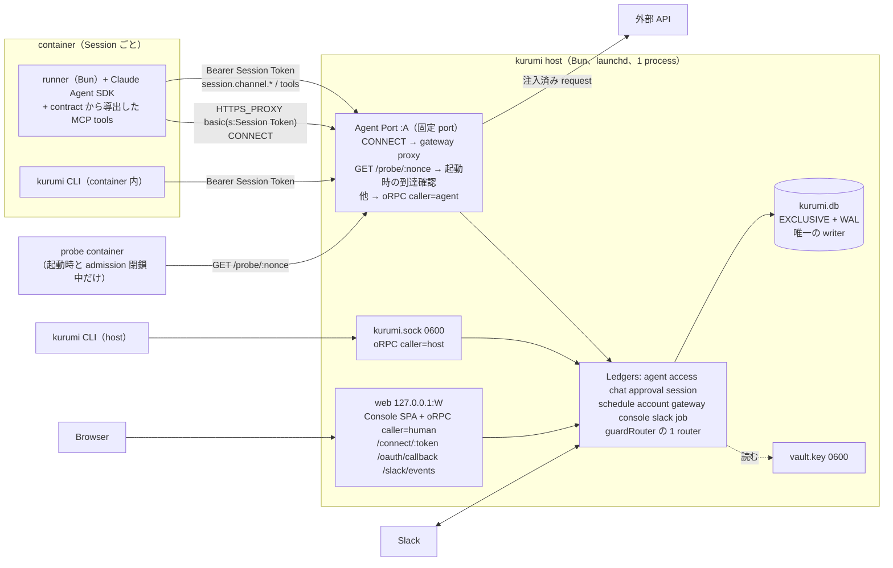

# kurumi module map

## repo の形

```
kurumi/
├── package.json          workspaces・catalog（oRPC、drizzle、zod、hono、trpc-cli、claude-agent-sdk を ^ 無しで固定）
├── tsconfig.json         1 つだけ（monica と同じ strict 設定）
├── .oxlintrc.json        entry ごとの no-restricted-imports、cross-domain-write、sync-transaction、spawn-env
├── container/
│   ├── Dockerfile        agent image（Bun、claude CLI、chromium）。runner と kurumi CLI の bundle を RO で mount する
│   └── skills/           container skill（agent-browser、frontend-engineer、self-customize、welcome、slack-*、canvas-work）
├── apps/
│   ├── host/             composition root。kurumi.db を開く唯一の process（launchd KeepAlive）
│   ├── cli/              `kurumi`。host では kurumi.sock、container では Agent Port に話す同じ binary
│   ├── runner/           container 内の agent-runner（Bun）。SQLite も mailbox file も持たない
│   └── web/              Console SPA の bundle（@kurumi/console/ui を組むだけ）
└── packages/
    ├── rpc/              domain なし。contract entry: meta 語彙（cli / agent / tool / humanHold）と Caller。
    │                     server entry: KurumiContext、Guard 型、guard middleware、guardRouter
    ├── ui/               domain なし。React 部品、CLI の table 整形
    ├── job/              system Job の tick（monica の Job Ledger から user Job を抜いたもの）
    ├── agent/            Agent Group、container config、Workspace、persona、CLAUDE.md 合成、skill、template
    ├── access/           User、role（owner / admin / scoped admin）、member、approver chain
    ├── chat/             Messaging Group、Wiring、Destination、User DM、ChannelAdapter seam、Card、terminal channel
    ├── approval/         guard の判定（verdict）、pending_approval（approver を行に焼く）、cardTarget、承認カード
    ├── session/          Session、inbound / outbound message、routing、container lifecycle と driver（probe 含む）、
    │                     Session Token、host↔container channel、question、self-mod、a2a、cross-session、typing
    ├── schedule/         Scheduled Task series
    ├── account/          vendor → service の catalog、Account（vendor ごとの identity）、account_grant（service 単位）、
    │                     Default Account、OAuth、Connection Request、connect_link、暗号化、token refresh。
    │                     credential material を返す唯一の口 `credentialFor`
    ├── gateway/          Agent Port、MITM proxy、CA、Egress Rule、hold、allowance、egress log、admission（bind + probe）
    ├── console/          Console channel adapter、Console の table、ui（Accounts 画面を含む）
    └── slack/            Slack adapter（bot instance ごと）と Slack 固有の機能すべて
```

各 domain package の entry は monica と同じ:`./schema`（drizzle）、`./contract`（oRPC + zod、drizzle-zod で導出）、`./server`（router、`create<D>Ledger`、`migrations`、`systemJobs`、他 domain 向けの同期メソッド）、`./ui`（console のみ。account の画面は console/ui が account/contract を使って描く）、`./testing`（fake の ContainerDriver、fake の upstream、fake の channel adapter）。CLI の整形が要る domain だけ `./cli`。root の `"."` は置かない。migration は package ごとに `migrations/<d>/` と `__drizzle_migrations_<d>`。account の `catalog.ts`、`select.ts`、`connect.ts` と gateway の `forward.ts` は entry に出さない内部 module。

domain の router は `implement(contract).$context<KurumiContext & { <d>Ledger }>()` で作り、guard には触れない。host が `guardRouter<HostContext>().router({...})` で全 domain の router を 1 つにまとめ、その時点で全 procedure の前に guard middleware が付く。`@orpc/server` の `os` を domain が直接使うのは lint で禁止する（`implement` だけ許す）。

## 依存の向き（一方向、上が下を import する）

```
            apps/host（全部を組む）   apps/cli → */contract   apps/runner → */contract   apps/web → console/ui
                                │
     ┌──────────────┬───────────┴──────────────┐
   slack          console                   gateway ───────────────┐
     │               │                          │                  │
     │               │                       account ┄┄(schema FK と contract の型だけ)┄┄┐
     │               │                          │                  │                   ┊
     │            schedule ────────┐            │                  │                   ┊
     │               │             ▼            ▼                  ▼                   ┊
     └──────────────────────────▶ session ◀───────────────────────────────────────────┘
                                   │
                                approval
                                   │
                                 chat
                                   │
                                access
                                   │
                                 agent
   rpc・ui・job: domain なし。誰でも import してよい
```

- gateway → account, session（`authenticate`、`notify`、`originOf`、driver の `probe` 型）, approval（`request`）
- account → agent, access。session へは schema の FK（`connection_request.session_id`）と contract の型（`AgentPrincipal`）だけ。session への書き込み（`postCard` / `replaceCard` / `notifySession`）は host が `SessionCards` として deps に渡す
- session → approval, chat, access, agent
- schedule → session（`enqueueTask` だけを `Pick`）, agent
- console → chat（adapter 型）。ui は account / session / approval / chat / agent の contract を読む
- slack → session, approval, chat, agent
- 逆向きの値は host が関数で渡す（monica ADR-0013）: session の `egress`（gateway の contribution と admission）、gateway の `probe`（session の driver）、account の `sessions`、chat の `adapters` と `sink`、approval の `handlers` と `originOf`。閉じたリストは union の `Record`（`ApprovalHandlers`、`cardOwners`）で、書き忘れは compile error になる。

## process と通信路



| 保存先 | writer | container から見えるか |
|---|---|---|
| `$KURUMI_HOME/kurumi.db`（全 domain の table。旧 v2.db・console.db・inbound.db・outbound.db・OneCLI postgres） | host のみ | 見えない（mount しない、port も無い） |
| `$KURUMI_HOME/vault.key` | host（初回生成） | 見えない |
| `$KURUMI_HOME/ca/combined-<sha>.pem`（公開 CA 証明書のみ。鍵は DB 内で暗号化） | host | RO mount |
| `$KURUMI_HOME/groups/<folder>/`（Workspace、memory、conversations、tasks log） | host（CLAUDE.md、container.json）と container（memory、作業ファイル） | RW mount（今と同じ） |
| `$KURUMI_HOME/sessions/<ag>/<sid>/inbox/` | host のみ（受信添付） | RO mount |
| `$KURUMI_HOME/sessions/<ag>/.claude-shared/` | container（SDK 状態）、host（skill link） | RW mount |
| `$KURUMI_HOME/runner/runner.js`、`kurumi.js` | host（build 時） | RO mount |

送信ファイル（send_file）は outbox ディレクトリを使わず RPC の multipart で上げる（上限 50 MiB）。

### 実機で確かめられている事実（Bun 1.4.3、Docker Desktop 29.6.1）

- CONNECT の socket に server 側の `TLSSocket` を被せる試作は、証明書の検証には通ったが、遅い client への応答の背圧を伝えず、応答全体を memory に溜めた。P04 は host ごとの `tls.createServer` を `127.0.0.1:0` で起こし、CONNECT の socket と loopback の接続を `stream.pipeline` でつなぐ。復号した接続は `node:http` に渡す（2026-10-22 の `proto-mitm` の試作）。
- host の `127.0.0.1` だけに bind した listener に、container の中の curl から `host.docker.internal:PORT` で届いた。MITM 越しの HTTPS も通った（2026-10-22 の試作）。kurumi は起動のたびに probe container でも確かめる。
- host の unix socket を bind mount しても container から connect できない。container の口は TCP に決まる。
- 試作では `tls.createServer` の ALPN を `['http/1.1']` に固定すると、h2 を申し出る curl も h1 で通った。Bun の `https.createServer` はこの ALPN 設定を無視した。WebSocket と長い SSE も試作では通っており、製品コードでの回帰試験は P05 が持つ。

## Feature Inventory → 置き場所

凡例: package（entry / 主な関数）。「落とす」は理由付き。

### A. チャット側

| # | 機能 | kurumi の置き場所 |
|---|---|---|
| 1 | Slack channel / thread / DM | slack（server: adapter） |
| 2 | 複数 Slack bot | slack（`slack_instance` 行ごとに adapter） |
| 3 | Socket Mode / webhook | slack（webhook は host の web listener に `/slack/events/:instance` で mount） |
| 4 | 端末チャット | chat（`chat.terminal` procedure + terminal adapter）、apps/cli の `kurumi chat` |
| 5 | Console web UI | console（server adapter + ui）、apps/web |
| 6 | engage mode | session（routing の `evaluateEngage`、sticky の修正込み） |
| 7 | Accumulate / drop | session（`trigger=false` 行、`dropped_message`） |
| 8 | session mode | session（`resolveSession`） |
| 9 | wiring の thread 上書きと channel 既定 | chat（wiring 列）+ adapter の既定、判定は session |
| 10 | Sender Scope | session（routing） |
| 11 | Unknown Sender Policy + Sender Admission | session（routing）+ approval（kind `sender.admission`） |
| 12 | Chat Registration | session + approval（kind `chat.registration`）、拒否は chat の `denied_at` |
| 13 | Dropped message 監査 | session（`dropped_message`、`session.dropped`） |
| 14 | typing | session（delivery 時に adapter.setTyping、heartbeat 中は維持） |
| 15 | 受信添付 | session（inbox へ書く）+ runner（formatter） |
| 16 | Slack の表の復元 | slack |
| 17 | Destination への send_message | session（`sendMessage` tool、ACL は chat の destination） |
| 18 | send_file | session（`sendFile`、RPC upload） |
| 19 | edit_message / add_reaction | session（seq で指す） |
| 20 | send_card | session（`sendCard`、agent の発言として描く） |
| 21 | ask_user_question | session（`askUserQuestion` は long poll、`pending_question`） |
| 22 | post_question | session（`postQuestion`） |
| 23 | `<message to>` / `<internal>` 封筒 + wrap nudge | runner |
| 24 | provider error の通知 | runner |
| 25 | slash command gate | session（routing の `gateCommand`）+ runner（/clear 等の実行） |
| 26 | session resume | runner + session（`channel.state`） |
| 27 | PreCompact で transcript 保存 | runner（`conversations/` は Workspace） |
| 28 | memory tree 注入 | runner + agent（scaffold） |
| 29 | Standing Instructions + 合成 CLAUDE.md | agent（`prepareWorkspace`）。tool の説明は contract の `meta.tool` から導出 |
| 30 | cross-session context | session |
| 31 | agent 間 message | session（a2a routing、`agent_message_policy`、approval kind `a2a.message`） |
| 32 | chat からの create_agent | agent（`agent.create`、agent:'scoped' + humanHold） |
| 33 | 新 agent 専用の Slack bot | slack |
| 34 | create_room / add_to_room、room canvas | slack（`rooms.*`、`canvas.*` tool） |
| 35 | A2A Slack room と hop limit | slack |
| 36 | canvas read / update | slack（agent tool） |
| 37 | Slack DM onboarding、thread 自動タイトル | slack |
| 38 | Slack join / leave、自動結線 | slack（chat の wiring を chat のメソッドで作る） |
| 39 | Self-Modification | session（`installPackages` / `addMcpServer`、agent:'hold'）+ agent（`updateConfig`）+ driver（image build） |
| 40 | 承認カード 3 ボタン + 理由取り込み | approval |
| 41 | Scheduled Task | schedule（+ session の task session、runner の script gate） |
| 42 | group ごとの timezone | agent（container_config） |
| 43 | welcome message | container skill + `chat.messagingGroups.send` |
| 44–46 | container skills | `container/skills/`、選択は agent |
| 47 | onecli-gateway / connect-apps skill | **置き換え**: 指示は `account.mine` / `account.connect` の `meta.tool.instructions` から CLAUDE.md に入る。skill は持たない |
| 48 | credential gateway 一式 | account + gateway |

### A'. 運用面

| # | 機能 | 置き場所 |
|---|---|---|
| 49 | `ncl groups` 一式 | agent（`kurumi agent …`）。`groups connect` は `kurumi account connect` |
| 50 | messaging-groups | chat |
| 51 | wirings | chat |
| 52 | users / roles / members | access |
| 53 | destinations / policies | chat（destinations）、session（a2a policies） |
| 54 | sessions | session |
| 55 | tasks | schedule |
| 56 | templates | agent |
| 57 | user-dms / dropped-messages / approvals / help / status | chat / session / approval / apps/cli（help）。`kurumi status` は各 domain の status を束ねる手書き command |
| 58 | CLI Scope | approval（`verdict` の `scoped`）+ agent（`cli_scope` 列）+ rpc（guard middleware） |
| 59 | mount allowlist | agent（`mountsFor`） |
| 60 | egress lockdown | gateway（contribution の network。probe も同じ network で走る）+ session（driver） |
| 61 | container 制限、model、fast mode | agent（container_config）+ session（spec） |
| 62 | 再起動・crash 回復 | session（adopt、reap、stale 判定）。circuit breaker は launchd の ThrottleInterval で代替 |
| 63 | 複数 host の fencing | **落とす**。EXCLUSIVE + `kurumi.lock` で 1 home 1 host。`host_instances` / `session_claims` / `host_lease` は要らない |
| 64 | upgrade tripwire、/update-* | **落とす**。kurumi は自分の repo で、upstream を merge しない |
| 65 | setup wizard | apps/cli の `kurumi setup`（Docker 確認、vault 生成、Anthropic key、Slack instance、launchd plist）。規模は大幅に小さい |
| 66 | /init-first-agent | `kurumi setup` の最後の段（owner 登録 + DM 結線 + welcome） |
| 67 | skill engine（nc: directive） | **落とす**。機能は core に直接書く（decision 1 の動機そのもの） |
| 68 | agent template | agent |
| 69 | uninstall | `kurumi setup --uninstall`（plist と home を消すだけ） |
| 70 | `scripts/q.ts` | `kurumi db query`（host が read-only で実行、caller=host のみ）。EXCLUSIVE なので外から開けない |
| 71 | community portal | **落とす**（使用の証拠なし。how.md の未解決の問い）。要るなら後から slack に |
| 72 | v1→v2 移行 | **落とす**（範囲外） |

### B. nanoclaw 側の gateway 機能

| # | 機能 | 置き場所 |
|---|---|---|
| N1 | gateway provider seam | **落とす**。gateway は 1 つで差し替えない。session と gateway の境界は `egress` の 2 関数と `probe` だけ |
| N2 | spawn 時の lease、CA staging、env | gateway（`contribution`） |
| N3 | Credential Approval coordinator | gateway（hold、allowance）+ approval（行、approver、cardTarget、timeout） |
| N4 | read-only 自動承認 | gateway の Egress Rule（既定 rule として seed。approve rule より高い priority の allow） |
| N5 | 障害時の admission gate | gateway（`admission`: binding → probing → open / unreachable / bind_failed）+ session（spawn 前に見る、inbound は pending） |
| N6 | `ncl groups connect` | account（`account.connect`、1 回限りの link を返す） |
| N7 | agent 向け指示 | account の `meta.tool.instructions` + gateway の refusal 本文（`next`） |
| N8 | gateway ごとの skill 選別 | **落とす**（gateway が 1 つ） |
| N9 | Anthropic credential の登録、版固定 | `kurumi account add-key anthropic --auto-grant`。版固定は不要（自前） |
| N10 | ChatGPT stub | **落とす**（claude のみ。Codex を足すとき vendor spec に stub 生成を足す） |

### C. OneCLI v1.42.0 の機能

| # | 機能 | 置き場所 |
|---|---|---|
| G1 | MITM proxy と token による身元 | gateway（Agent Port）。token 無しの素通しは **やめる**（407） |
| G2 | CA と leaf cert | gateway（CA 鍵は DB 内で暗号化、leaf は CONNECT の host ごと、memory に 24 時間） |
| G3 | container config API | gateway（`contribution`、in-process 呼び出し） |
| G4 | agent 作成と token 発行 | session（container 行と Session Token） |
| G5 | Secret 注入と暗号化 | account（kind `key` の Account）。任意 host の generic secret は Open question |
| G6 | provider registry | account（`catalog.ts`、vendor → service の 1 object から全部導出。grant の CHECK も生成） |
| G7 | OAuth 接続、複数アカウント、再接続、BYOC | account（`connection_request`、`connect_link`、`oauth_client`、`(vendor, subject)` で upsert、1 回の同意で複数 service） |
| G8 | lazy refresh と書き戻し | account（`credentialFor` の single-flight refresh） |
| G9 | agent ごとの付与 | account（`account_grant` は service 単位、既定 deny、`autoGrant` は明示） |
| G10 | request ごとの connection 選択 | account（`selectAccount` + `readSelector` + vendor の `selectorShape`） |
| G11 | policy rule | gateway（`egress_rule`、account / service / host のちょうど 1 つを DB の CHECK で） |
| G12 | 承認保留と summary | gateway（hold）+ catalog の service ごとの `summarize` |
| G13 | 401/403 の actionable error | gateway（`refusalResponse`、`REFUSAL_STATUS`。URL ではなく tool 名を返す） |
| G14 | request log | gateway（`egress_log`、account と service 付き、30 日で剪定） |
| G15 | MITM 内 WebSocket | gateway。service の host だけ MITM するので後回し可（unit 1 で背圧と一緒に確認） |
| G16 | SigV4、GitHub trailer | 後回し。要るとき service spec に `finalize` を足す |
| G17 | Vault（1Password 等） | **落とす**（使用不明） |
| G18 | cache 無効化 | **落とす**。grant は毎 request DB を引く（同 process、index 付き） |
| G19 | dashboard | console/ui の Accounts・Rules・Activity 画面 |

### D. Console

| # | 機能 | 置き場所 |
|---|---|---|
| D1 | HTTP + SSE server | apps/host の web listener（Host header allowlist、JSON 必須）+ console の `events` iterator |
| D2 | sidebar、chat、preview | console/ui |
| D3 | Inbox | console（owner 宛の承認カード。cardTarget の既定 `origin` で元の chat が無いときだけ owner の Inbox） |
| D4 | Group Chat | console |
| D5 | panel | console/ui（agent、schedule の contract を読む） |
| D6 | template から新規 agent | console/ui → `agent.create` |
| D7 | label、avatar | console（`appearance`） |
| D8 | 未読と通知 | console |
| D9 | カード | console/ui（chat の Card を描く。`private-link` の返事はその場で遷移） |
| D10 | 接続済みアカウント一覧と chat 内カード | console/ui の Accounts 画面（group × service ごとに付与・既定・取り消しを書ける）+ Connect Card |
| D11 | 設定 | console |

## 最初の実装単位（それぞれ検証できる状態で終わる）

1. **Agent Port の残りの spike**。host ごとの leaf cert（CONNECT の host で選ぶ）と、container から 127.0.0.1 bind への到達は確認済み。残りは probe container の実装と、HTTP/2（ALPN で h1 に落とすかどうか）、WebSocket、長い SSE の背圧。検証は container 内の curl が proxy 経由で fake upstream に届き、注入された header が upstream で見えること。
2. **account の純粋部分と catalog**。`catalog.ts`、`selectAccount`、`readSelector`、schema（CHECK と複合 FK）と migration。検証は Group 1（Google A/B/C の gmail）と Group 2（Google B の gmail + Google A の google-calendar）の表で 0 件・1 件・既定・名指し・未付与・`service ∉ account.services` の付与拒否・service が別の vendor に属する grant の CHECK 違反を test で通すこと。Google の文書では 1 回の同意で gmail + calendar を取れ、`include_granted_scopes` の refresh token は合わさった許可を表す。実際のログインでそれを確かめ、一部の scope だけ許可したときに付与がその分だけになることも確かめる。
3. **session channel と echo runner**。host（session + agent + chat の terminal adapter）と、Claude を呼ばず echo する runner。検証は `kurumi chat` で送った文が container を起こして返事が戻ること、host を kill して再起動しても container が adopt され次の文も返ること。
4. **gateway の注入と selector**（完了。[#16](https://github.com/ashigirl96/kurumi-v1/pull/16)、[#17](https://github.com/ashigirl96/kurumi-v1/pull/17)、[#18](https://github.com/ashigirl96/kurumi-v1/pull/18)、[#19](https://github.com/ashigirl96/kurumi-v1/pull/19)、[#20](https://github.com/ashigirl96/kurumi-v1/pull/20)）。Anthropic key を `autoGrant` で入れ、本物の Claude Agent SDK が proxy 経由で動く。検証は terminal chat で会話でき、`egress_log` に account 付きの行が残ること。SDK が `kurumi:…` を credential として受け入れるかを確かめ、拒むなら anthropic の `selectorShape`（`sk-ant-kurumi-…`）が通ることを確かめる。
5. **approval と Egress Rule の approve**。検証は Gmail send に approve rule を置き、Console Inbox のカードに account、service、chat 名が出て、承認で元の request が完了すること。host 再起動を挟んだ場合は allowance と session への通知で再送が通ることを確かめる。agent が本文を作り直した再送が別の hold になる（fingerprint が body を含むため）ことも確かめ、その頻度を見て運用を決める。
6. **in-chat connection**。Console と Slack の両方で `connect_account` → カード → 承認者のクリック → 1 回限りの link → OAuth → 自動で再開、を通す。検証は二度押し（link が 2 本、authorize URL は 1 つ）、承認者でない人のクリック（private な拒否文）、使用済みの link と 5 分経った link、callback の再読込、期限切れ、callback 前の host 再起動を test で起こすこと。
7. 以降: Slack の残り、schedule、self-mod、a2a、Console の残り画面。
